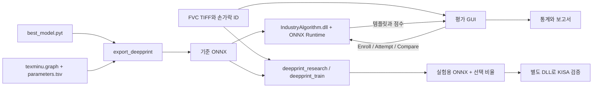
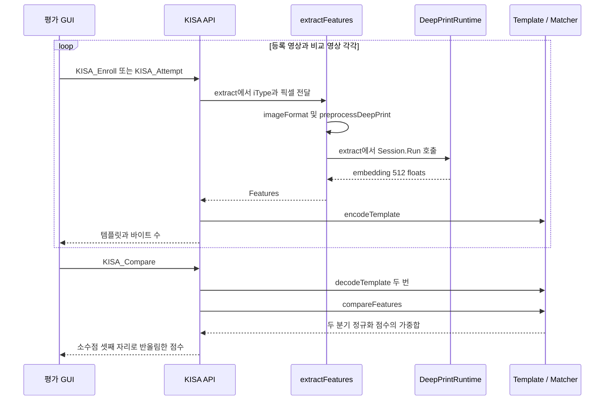
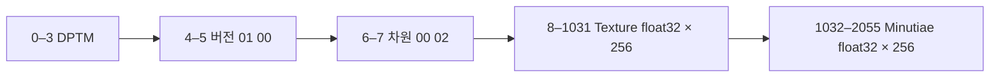

# DeepPrint 지문 인식 알고리즘과 평가 시스템

`progess`의 Windows x64 구현을 기준으로, 등록 영상 한 장이 템플릿이 되고 두 템플릿의 점수가 EER로 집계되는 경로를 설명한다. 처음 읽는다면 **2절의 호출도 → 6절의 템플릿 → 7절의 점수 → 9절의 평가** 순서로 보면 된다. 학습한 후보가 어떤 근거로 시연 모델에 채택되거나 제외됐는지는 12절에 정리했다. 설치와 GUI 실행 명령은 [루트 README](../README.md)에 있다.

[실행 파이프라인](#2-runtime-inference-pipeline) · [ONNX 레이어 표](#4-deepprint-model-architecture) · [학습과 손실함수](#8-model-training-and-fine-tuning) · [배포 설정](#11-current-deployment-configuration) · [실험 결과](#12-experimental-results-and-limitations) · [알고리즘별 소스 색인](#13-algorithm-to-source-mapping)

## 1. Project Architecture

| 영역 | 실행 단위와 소스 | 입력 → 출력 | 주요 의존성 |
|---|---|---|---|
| Model Generation | `export_deepprint.exe`, [변환 진입점](../tools/deepprint/export_model.cpp), [그래프·배치표](../tools/deepprint/architecture/) | 공개 체크포인트 + 고정 그래프 → 배포 가능 ONNX, 해시 JSON | C++17, 자체 protobuf wire 처리, Windows BCrypt |
| Runtime Inference | `IndustryAlgorithm.dll`, [KISA 진입점](api/kisa_api.cpp), [feature](feature/), [matching](matching/) | 회색조 픽셀 → 템플릿, 템플릿 쌍 → 정합 점수 | [KISA 공개 헤더](../include/kisa_api.h), ONNX Runtime CPU, 모델 파일 |
| Model Training | `deepprint_train.exe`, [학습 진입점](../tools/deepprint/train_main.cpp), [학습 연산](../tools/deepprint/training.cpp) | 기준 모델 + FVC + 분할 → 후보 파라미터, ONNX, 검증 CSV | 특징 추출에는 ORT, 역전파에는 네이티브 LibTorchSharp·LibTorch CPU |
| Research | `deepprint_research.exe`, [실험 진입점](../tools/deepprint/research_main.cpp), [공통 데이터·추론](../tools/deepprint/research_data.cpp) | 영상·쌍·분할·모델 → 캐시, 전처리 비교, ONNX/KISA 대조 | ORT, TIFF 로더, 모드에 따라 시험 대상 DLL |
| Evaluation | `fingerprint_compare.exe`, [GUI](../app/comparison_window.cpp), [비교·통계·보고서](../app/fingerprint_image.cpp) | x64 DLL + DB + 비교 규칙 → 쌍별 결과, 지표, HTML/RTF와 SVG | Win32, WIC, 공개 KISA 함수 |
| 일괄 평가 | `augment_fvc`, `evaluate_noise`, `tune_weights`, [영상 증강](../tools/noise/), [평가 도구](../tools/evaluation/) | 원본·변형·저장 템플릿 → 조건별 성능과 가중치 비교 | [FVC/TIFF 공통 코드](../tools/fvc/), [검증 지표](../tools/evaluation/verification_metrics.cpp) |

[include](../include/)는 ABI와 센서 규격, [src](./)는 DLL 및 [증강 조건 데이터](experiments/fvc_augmentation.json), [app](../app/)은 GUI, [tools](../tools/)는 오프라인 실행 파일을 담는다. [data/fvc](../data/fvc/)는 실험 원본, [tests](../tests/)와 [fixtures](../tests/fixtures/deepprint/)는 검증 코드와 독립 기준 벡터다. [log](../log/)는 분할·시험 성적, [reports](../reports/)는 생성된 보고서, [reference](../reference/)는 과제·원본 자료, [archive](../archive/)는 이전 산출물이다. 로컬 `build/`에는 모델·실행 파일·실험 중간 결과를 둔다. [CMakeLists.txt](../CMakeLists.txt)에서 GUI, DeepPrint DLL, 연구 도구를 별도 타깃으로 구성하며 [프리셋](../CMakePresets.json)이 빌드 구성을 정한다.



## 2. Runtime Inference Pipeline

`KISA_Enroll`과 `KISA_Attempt`는 동일한 추출기를 호출한다. GUI는 TIFF를 읽어 픽셀을 넘기고, DLL은 템플릿의 내부 형식을 소유한다. 아래 호출도는 등록 한 번과 비교 한 번을 나타낸다. GUI는 준비한 등록 템플릿을 여러 비교에 재사용할 수 있다. [평가 실행](../app/fingerprint_image.cpp) · [API 구현](api/kisa_api.cpp)



### 단계별 입출력과 구현 위치

`H,W`는 입력 크기, `h,w`는 선택 영역 크기, `S=max(h,w)`다. 텐서는 별도 표시가 없으면 `float32`, 영상 좌표 순서는 행·열, ONNX 텐서 순서는 `N,C,H,W`다. 4·5단계는 입력 종류에 따라 하나를 택한다. 6~8단계의 패딩·보간·나눗셈은 같은 루프에서 수행하며, 10~14단계는 9단계의 `Run` 안에서 실행된다.

| 단계 | 실제 함수 또는 그래프 노드 | 입력 → 출력 / 주요 연산 |
|---|---|---|
| 1. API | [`KISA_Enroll / KISA_Attempt → extract`](api/kisa_api.cpp) | `int iType`, `unsigned char*`, 호출자 버퍼(템플릿 1,000,000·오류 256바이트) → 성공 1 또는 실패 0, 오류 코드·길이 기록 |
| 2. 크기 확인 | [`extractFeatures`](feature/deepprint_extractor.cpp) → [`imageFormat`](../include/image_format.h) | `iType → {width,height}`. 미지원 형식은 실패. ABI에 픽셀 버퍼 길이 인자가 없어 각 형식에 맞는 연속 `uint8[H,W]`가 전제 |
| 3. 전처리 선택 | [`deepPrintPreprocessingForType`](feature/deepprint_preprocessing.h) | `iType`과 빌드 옵션 → `Standard / Bilateral / ForegroundCrop` |
| 4. Bilateral | [`filterBilateral`](feature/deepprint_preprocessing.cpp) | `uint8[H,W] → uint8[H,W]`. 3×3의 위치·밝기 가중 평균 |
| 5. ROI | [`foregroundCrop`](feature/deepprint_preprocessing.cpp) | `uint8[H,W] → Crop{left,top,width,height}`. 블록 통계로 경계를 찾고 각 축 20% 확장 |
| 6. White Padding | [`preprocessDeepPrintVariant`](feature/deepprint_preprocessing.cpp) | `h×w → S×S` 정사각형에 해당하는 좌표계. 흰색을 1로 취급 |
| 7. AA Resize | [`makeWeights / preprocessDeepPrintVariant`](feature/deepprint_preprocessing.cpp) | 가로 중간 버퍼 `[S,299]` → 세로 필터 → `[299,299]` |
| 8. Pixel Normalization | [`preprocessDeepPrintVariant`](feature/deepprint_preprocessing.cpp) | 보간 입력을 읽으며 각 `uint8` 픽셀을 `float(pixel)/255`로 변환 |
| 9. ORT 추론 | [`runtime().extract / Ort::Session::Run`](feature/deepprint_extractor.cpp) | `image [1,1,299,299] → embedding [1,512]`. 형상·자료형·수치 검사 |
| 10. Gabor / 이진화 | [그래프](../tools/deepprint/architecture/texminu.graph) `/binarize/*` | 명암 정규화, 다중 크기·방향 응답, 마스크 → 0/1 `[1,1,299,299]` |
| 11. Shared Stem | [그래프](../tools/deepprint/architecture/texminu.graph) `/stem/features/*` | 이진 영상 → `[1,384,35,35]` 공통 특징 맵 |
| 12. Texture | [그래프](../tools/deepprint/architecture/texminu.graph) `/texture/*`, `/Div` | 공통 맵 → `[1,1536]` → 투영·L2 정규화 → `[1,256]` |
| 13. Minutiae | [그래프](../tools/deepprint/architecture/texminu.graph) `/minutia_stem/*`, `/minutia_embedding/*` | 공통 맵 → `[1,1024]` → 투영·L2 정규화 → `[1,256]` |
| 14. Concatenation | [그래프](../tools/deepprint/architecture/texminu.graph) `/Concat` | 두 분기를 질감, 특징점 순으로 `axis=1`에 연결 → `[1,512]` |
| 15. Encoding | [`encodeTemplate`](feature/template_manager.cpp) | `Features → unsigned char[2056]`. 8바이트 헤더와 특징 512개 복사 |
| 16. Decoding | [`KISA_Compare`](api/kisa_api.cpp) → [`decodeTemplate`](feature/template_manager.cpp) | 등록·비교 버퍼 각각 → 헤더와 값을 확인한 `Features` 두 개 |
| 17. Branch cosine | [`compareFeatures → compareBranches → cosineScore`](matching/fingerprint_matcher.cpp) | 각 분기의 두 256차원 벡터 → 내적과 두 노름으로 `double` 코사인 계산 |
| 18. Score normalization | [`cosineScore`](matching/fingerprint_matcher.cpp) | 분기별 코사인 → `(clamp(c,−1,1)+1)/2` |
| 19. Weighted fusion | [`fuseBranchScores`](matching/fingerprint_matcher.cpp) | `BranchSimilarities`와 질감 비중 → `0.22 × texture + 0.78 × minutiae` |
| 20. 점수 반환 | [`KISA_Compare`](api/kisa_api.cpp) | 가중합 → `double* score`에 0.001 단위 기록. GUI가 반환 점수에 판정 기준 적용 |

두 함수의 연결부를 보면 세부 구현을 찾기 쉽다. 첫 블록은 [`extractFeatures`](feature/deepprint_extractor.cpp)의 전처리·추론 호출이고, 두 번째는 [`KISA_Compare`](api/kisa_api.cpp)의 마지막 계산이다.

```cpp
auto input = preprocessDeepPrint(image, format, deepPrintPreprocessingForType(iType, FINGERPRINT_FVC2004_ROI));
runtime().extract(input, features);
```

```cpp
const double similarity = fingerprint::compareFeatures(enrolled, probe);
*score = std::round(similarity * 1000.0) / 1000.0;
```

ORT 호출부의 이름은 모델의 입출력 이름과 일치해야 한다. 텐서의 메모리는 `image` 벡터에서 빌리며 배치 축을 포함해 형상을 명시한다. [`DeepPrintRuntime::extract`](feature/deepprint_extractor.cpp)

```cpp
auto input = Ort::Value::CreateTensor<float>(memory_, image.data(), image.size(),
                                              kInputShape.data(), kInputShape.size());
const char* inputName = "image";
const char* outputName = "embedding";
auto output = session_.Run(Ort::RunOptions{nullptr}, &inputName, &input, 1, &outputName, 1);
```

## 3. Image Preprocessing

### 입력과 배포 경로

[`imageFormat`](../include/image_format.h)은 `1 → 448×478`, `2 → 300×300`, `3 → 640×480`을 돌려준다(가로×세로). 센서 코드 `5 → 280×320`, `7 → 292×525`, `8 → 248×292`, `9 → 288×320`도 헤더에서 확인할 수 있다. [전처리 선택 함수](feature/deepprint_preprocessing.h)에서 `iType=2`는 Bilateral, `iType=3`이고 `FINGERPRINT_FVC2004_ROI=ON`이면 ForegroundCrop, 나머지 지원 형식은 Standard다. Standard는 전체 프레임을 패딩하고 축소·정규화한다. [배포 래퍼](feature/deepprint_preprocessing.cpp)는 다음 인자를 넘긴다.

```cpp
return preprocessDeepPrintVariant(image, format, preprocessing, 12, 20, false);
```

입력 크기의 유효성은 [`extractFeatures`](feature/deepprint_extractor.cpp)에서 먼저 확인하고, 처리 방법은 [`deepPrintPreprocessingForType`](feature/deepprint_preprocessing.h)에서 선택한다.

```cpp
const auto format = imageFormat(iType);
if (format.width == 0) {
    return false;
}
```

```cpp
if (iType == 2) {
    return DeepPrintPreprocessing::Bilateral;
}
if (iType == 3 && useFvc2004Roi) {
    return DeepPrintPreprocessing::ForegroundCrop;
}
return DeepPrintPreprocessing::Standard;
```

### Bilateral Filter와 Lookup Table

중심 $p$와 3×3 이웃 $q$의 거리 및 명암 차이를 함께 사용해 융선 경계 사이의 평균화를 줄인다. 배포 설정은 공간 $\sigma_s=1$픽셀, 밝기 $\sigma_r=12$ (8비트 명암 단위)다.

$$
w_{pq}=\exp\left(-\frac{\|p-q\|^2}{2\sigma_s^2}-\frac{(I_q-I_p)^2}{2\sigma_r^2}\right),
\qquad I'_p=\operatorname{nearbyint}\left(\frac{\sum_q w_{pq} I_q}{\sum_q w_{pq}}\right).
$$

제곱 거리는 0, 1, 2이고 절대 명암 차이는 0~255이므로 `table[3][256]`이면 된다. `filterBilateral`의 함수 지역 `static` 테이블은 σ=12일 때 한 번 만들어 재사용한다. 실험용 σ는 호출 시 테이블을 만든다. 경계 밖 좌표는 가장 가까운 테두리 픽셀로 제한한다. [필터 구현](feature/deepprint_preprocessing.cpp)

```cpp
const float weight = weights[dx * dx + dy * dy][std::abs(neighbor - center)];
total += weight;
weighted += neighbor * weight;
```

### 전경 ROI, 여백, 중심 이동

`foregroundCrop`은 완전한 16×16 블록을 순회한다. $n=256$, $S_1=\sum I$, $S_2=\sum I^2$라 하면 분산은 $(nS_2-S_1^2)/n^2$이다. **분산 ≥ 144이고 밝기 180 미만인 픽셀 비율 ≥ 8%**인 블록만 활성화한다. 한 행·열에 활성 블록이 2개 이상 있어야 유효하고, 유효 행과 열이 각각 4개 이상이어야 잘라낸다. 근거가 부족하면 원본 전체를 쓴다. 최초·마지막 유효 블록 경계 폭 또는 높이 $L$마다 각 끝에 $\lfloor(20L+50)/100\rfloor$ 픽셀을 보태고 원본 경계에서 제한한다. [`foregroundCrop`](feature/deepprint_preprocessing.cpp)

```cpp
if (pixels * squares - sum * sum >= pixels * pixels * minimumVariance && dark * 100 >= pixels * 8) {
    ++activeRows[row];
    ++activeColumns[column];
}
```

**연구용 ForegroundCenter**는 여백 0의 전경 상자를 구한 뒤 원래 크기의 흰 캔버스에 영상을 평행 이동한다. 별도의 `align` 실험은 299×299 입력에서 중심만큼 또는 절반만큼 이동하고 주축 회전을 시험한다. 배포 설정은 FVC2004에서 Crop을 택한다. [픽셀 좌표계 중심 이동](feature/deepprint_preprocessing.cpp) · [입력 정렬 실험](../tools/deepprint/preprocessing_study.cpp)

### White Padding, Antialiased Resize, Pixel Normalization

`S=max(h,w)`로 두고 왼쪽·위 여백은 각각 `(S-w)/2`, `(S-h)/2`의 정수 몫이다. 정사각형 전체를 복사하는 비용을 줄이려고 가로 필터에서 빈 열을 `1.0f`로 읽고 빈 행은 흰색으로 초기화한다. 출력 인덱스 $j$의 중심은 $(j+0.5)S/299$다. 입력 인덱스 $i$와 정규화 거리 $d=|i+0.5-(j+0.5)S/299|/\max(1,S/299)$를 사용한다. 배포 Bilinear의 계수는 $\max(0,1-d)$이며, 각 위치에서 합이 1이 되도록 정규화한다. 축소할 때 입력 지지 폭을 넓혀 고주파의 접힘을 줄이고 가로·세로 순으로 적용한다. [`makeWeights / preprocessDeepPrintVariant`](feature/deepprint_preprocessing.cpp)

```cpp
const float pixel = column >= 0 && column < crop.width ? line[column] / 255.0f : 1.0f;
value += coefficient * pixel;
```

**실험용 Bicubic**은 $d<1$에서 $1.5d^3-2.5d^2+1$, $1\le d\le2$에서 $-0.5d^3+2.5d^2-4d+2$를 사용한다. 마지막 출력은 $[0,1]$로 제한한다. 최종 버퍼는 행 우선 `float[299×299]`이고 ORT가 이를 `[1,1,299,299]`로 본다. 이 단계의 `/255`와 다음 절의 영상별 min–max 정규화는 서로 다른 연산이다.

## 4. DeepPrint Model Architecture

### 모델 경계와 Gabor Binarization

시연 모델은 `DeepPrint_TexMinu`이다. [`texminu.graph`](../tools/deepprint/architecture/texminu.graph)는 ONNX opset 17의 `ModelProto`다. 연산 노드 668개, initializer 400개 중 394개가 [배치표](../tools/deepprint/architecture/parameters.tsv)의 학습 텐서다. 나머지 6개는 방향 필터 3개, blur 필터 1개, resize 행렬 2개다. 아래 수치와 노드 이름은 이 그래프를 읽고 시연용 ONNX의 동일 노드에서 형상을 대조한 결과다. [그래프의 출처와 버전](../tools/deepprint/architecture/README.md)

1. `/binarize/ReduceMin, ReduceMax, Where, Div`가 영상별 $J=(I-\min I)/(\max I-\min I)$를 만든다. 범위가 0이면 분모 1을 써서 결과가 0이다.
2. 기준 ridge width 1.8인 고정 **Gabor 필터 뱅크**가 방향성 융선·골 응답을 만든다. 커널 크기 5×5, 9×9, 15×15마다 방향 16개이고 가중치 형상은 `[16,1,k,k]`다. 각 뱅크는 덧씌운 사인 패턴과 Gaussian 창에 해당하는 고정 계수를 사용한다. 런타임은 저장된 계수로 valid `Conv`를 수행한다. 별도 방향 검출기를 학습하거나 커널을 매번 합성하는 단계는 없다.
3. 어떤 입력 $X$의 뱅크 응답은 $R_k(X)=\max(0,-\min_\theta(K_{k,\theta}\star X))$다. 가장자리엔 0을 패딩해 원래 크기를 복구한다. 세 크기의 응답을 픽셀별 최댓값으로 합치고 min–max 정규화해 융선 $R$과 골 $V$를 만든다. 융선 입력은 모두 $J$, 골 입력은 5×5에서 $-J$, 나머지 두 크기에선 $1-J$다. 이는 그래프의 `Neg`와 `Sub_2` 연결에서 확인할 수 있다.
4. $R+V$에 reflect padding과 고정 7×7 blur를 적용하고 `> 0.1`로 영역 마스크를 만든다. 두 `MatMul`이 299→269로 축소하고 각 변에 15픽셀을 0으로 패딩해 마스크 $M$을 만든다. $D=R-V$라 하면 CNN에 전달되는 이진 영상은 다음과 같다. `Greater_4`의 결과를 `Cast_3`가 float로 바꾼다.

$$
B=\mathbf{1}\!\left[M\cdot\operatorname{clip}\!\left(8D-7\operatorname{mean}(D),0,1\right)>0.2\right].
$$

### Shared CNN Stem과 두 임베딩 분기

다음 표에서 공간 특징 맵은 `C×H×W`, 벡터는 차원 수로 썼다. 배치 크기는 모두 1이다. Inception 블록은 서로 다른 수용 영역의 연산을 병렬로 적용한 뒤 채널 축에서 합친다. 배포 그래프에서는 Conv+BatchNorm이 결합되어 있으며 해당 활성화는 `Relu(x)=max(0,x)`다. 특징점 임베딩 끝의 독립 Conv 4개는 그래프에서 차례로 직접 연결된다.

| 그래프 구간 | 주요 연산 | 입력 → 출력 |
|---|---|---|
| `stem/features.0…2` | Conv 3×3 세 번. stride 2,1,1 / padding 0,0,1 | 1×299×299 → 32×149×149 → 32×147×147 → 64×147×147 |
| `stem/features.3…5` | 병렬 Conv/Pool·Concat을 포함하는 Mixed 블록 | 64×147×147 → 160×73×73 → 192×71×71 → **384×35×35** |
| `texture.0` | Inception A ×4, Reduction A | 384×35×35 → 1024×17×17 |
| `texture.1` | Inception B ×7, Reduction B | 1024×17×17 → 1536×8×8 |
| `texture.2…6` | Inception C ×3, AveragePool 8×8, Flatten, Gemm | 1536×8×8 → 1536 → **256** |
| `minutia_stem/features.0…5` | Inception A ×6 | 384×35×35 → 384×35×35 |
| `minutia_embedding/_0_block` | Conv 3×3 ×4, padding 1, stride 1,2,1,2 | 384×35×35 → 768×35×35 → 768×18×18 → 896×18×18 → 1024×9×9 |
| `minutia_embedding/_1…4` | MaxPool 9×9, Flatten, Gemm | 1024×9×9 → 1024 → **256** |
| `/ReduceL2, /Div` 및 특징점 쪽 동명 연산, `/Concat` | 분기별 L2 정규화 후 채널 순서대로 연결 | 256 + 256 → **[1,512]** |

Conv는 위치마다 $\sum_{c,u,v}W_{o,c,u,v}X_{c,\,is_h+u-p_h,\,js_w+v-p_w}+b_o$를 계산한다. AveragePool은 창의 평균을, MaxPool은 최댓값을 취한다. Flatten은 배치 축을 보존해 펴고, Gemm은 $z=Wx+b$로 투영한다. [배치표](../tools/deepprint/architecture/parameters.tsv)의 `texture.6.weight`와 `minutia_embedding._4_linear.weight`가 각각 `[256,1536]`, `[256,1024]`다. 각 $z$를 $z/\max(\|z\|_2,10^{-12})$로 만든 뒤 연결한다. 출력은 분기마다 256개의 실수이며 특징점 좌표 목록이나 신원별 확률을 출력하는 경로는 배포 그래프에 없다.

`Conv`와 `Gemm`에 들어가는 실제 입력 이름의 예다. 아래는 ONNX의 `NodeProto.input/output`을 텍스트로 옮긴 것이다. 추론 시 실행되는 모델 부분의 원본 구현 단위는 이 노드다. [그래프 파일](../tools/deepprint/architecture/texminu.graph)

```text
/binarize/responses.0/Conv       Conv(/binarize/Div_output_0, binarize.responses.0.pattern)
/stem/features/features.0/conv/Conv  Conv(/binarize/Cast_3_output_0, onnx::Conv_2090, onnx::Conv_2091)
/texture/texture.6/Gemm          Gemm(/texture/texture.4/Flatten_output_0, texture.6.weight, texture.6.bias)
/minutia_embedding/_4_linear/Gemm  Gemm(/minutia_embedding/_2_flatten/Flatten_output_0, minutia_embedding._4_linear.weight, minutia_embedding._4_linear.bias)
/Concat                          Concat(/Div_output_0, /minutia_embedding/Div_output_0) -> embedding
```

### 그래프 노드별 측정값

이 표는 그래프의 Conv 202개, AveragePool 20개, MaxPool 5개, Flatten 2개, Gemm 2개를 모두 포함한다. 커널·stride·padding은 노드 속성을 읽고, 형상은 고정 그래프와 노드가 동일한 시연 모델에서 각 입력·출력에 `Shape`를 붙여 CPU로 확인했다. 배치와 채널을 생략하지 않았다. `—`는 해당 속성을 사용하지 않는 연산이다.

<details>
<summary>binarize · 7개 연산의 kernel / stride / padding / 형상</summary>

| ONNX 노드 (해당 경로 아래) | 연산 | 입력 N×C×H×W 또는 N×D | 출력 | Kernel | Stride | Pad 상·좌·하·우 |
|---|---|---|---|---|---|---|
| `responses.0/Conv` | Conv | 1×1×299×299 | 1×16×295×295 | 5×5 | 1×1 | 0,0,0,0 |
| `responses.0_1/Conv` | Conv | 1×1×299×299 | 1×16×295×295 | 5×5 | 1×1 | 0,0,0,0 |
| `responses.1/Conv` | Conv | 1×1×299×299 | 1×16×291×291 | 9×9 | 1×1 | 0,0,0,0 |
| `responses.1_1/Conv` | Conv | 1×1×299×299 | 1×16×291×291 | 9×9 | 1×1 | 0,0,0,0 |
| `responses.2/Conv` | Conv | 1×1×299×299 | 1×16×285×285 | 15×15 | 1×1 | 0,0,0,0 |
| `responses.2_1/Conv` | Conv | 1×1×299×299 | 1×16×285×285 | 15×15 | 1×1 | 0,0,0,0 |
| `Conv` | Conv | 1×1×305×305 | 1×1×299×299 | 7×7 | 1×1 | 0,0,0,0 |

</details>

<details>
<summary>stem · 13개 연산의 kernel / stride / padding / 형상</summary>

| ONNX 노드 (해당 경로 아래) | 연산 | 입력 N×C×H×W 또는 N×D | 출력 | Kernel | Stride | Pad 상·좌·하·우 |
|---|---|---|---|---|---|---|
| `features/features.0/conv/Conv` | Conv | 1×1×299×299 | 1×32×149×149 | 3×3 | 2×2 | 0,0,0,0 |
| `features/features.1/conv/Conv` | Conv | 1×32×149×149 | 1×32×147×147 | 3×3 | 1×1 | 0,0,0,0 |
| `features/features.2/conv/Conv` | Conv | 1×32×147×147 | 1×64×147×147 | 3×3 | 1×1 | 1,1,1,1 |
| `features/features.3/maxpool/MaxPool` | MaxPool | 1×64×147×147 | 1×64×73×73 | 3×3 | 2×2 | 0,0,0,0 |
| `features/features.3/conv/conv/Conv` | Conv | 1×64×147×147 | 1×96×73×73 | 3×3 | 2×2 | 0,0,0,0 |
| `features/features.4/branch0/branch0.0/conv/Conv` | Conv | 1×160×73×73 | 1×64×73×73 | 1×1 | 1×1 | 0,0,0,0 |
| `features/features.4/branch0/branch0.1/conv/Conv` | Conv | 1×64×73×73 | 1×96×71×71 | 3×3 | 1×1 | 0,0,0,0 |
| `features/features.4/branch1/branch1.0/conv/Conv` | Conv | 1×160×73×73 | 1×64×73×73 | 1×1 | 1×1 | 0,0,0,0 |
| `features/features.4/branch1/branch1.1/conv/Conv` | Conv | 1×64×73×73 | 1×64×73×73 | 1×7 | 1×1 | 0,3,0,3 |
| `features/features.4/branch1/branch1.2/conv/Conv` | Conv | 1×64×73×73 | 1×64×73×73 | 7×1 | 1×1 | 3,0,3,0 |
| `features/features.4/branch1/branch1.3/conv/Conv` | Conv | 1×64×73×73 | 1×96×71×71 | 3×3 | 1×1 | 0,0,0,0 |
| `features/features.5/conv/conv/Conv` | Conv | 1×192×71×71 | 1×192×35×35 | 3×3 | 2×2 | 0,0,0,0 |
| `features/features.5/maxpool/MaxPool` | MaxPool | 1×192×71×71 | 1×192×35×35 | 3×3 | 2×2 | 0,0,0,0 |

</details>

<details>
<summary>texture · 157개 연산의 kernel / stride / padding / 형상</summary>

| ONNX 노드 (해당 경로 아래) | 연산 | 입력 N×C×H×W 또는 N×D | 출력 | Kernel | Stride | Pad 상·좌·하·우 |
|---|---|---|---|---|---|---|
| `texture.0/texture.0.0/branch0/conv/Conv` | Conv | 1×384×35×35 | 1×96×35×35 | 1×1 | 1×1 | 0,0,0,0 |
| `texture.0/texture.0.0/branch1/branch1.0/conv/Conv` | Conv | 1×384×35×35 | 1×64×35×35 | 1×1 | 1×1 | 0,0,0,0 |
| `texture.0/texture.0.0/branch1/branch1.1/conv/Conv` | Conv | 1×64×35×35 | 1×96×35×35 | 3×3 | 1×1 | 1,1,1,1 |
| `texture.0/texture.0.0/branch2/branch2.0/conv/Conv` | Conv | 1×384×35×35 | 1×64×35×35 | 1×1 | 1×1 | 0,0,0,0 |
| `texture.0/texture.0.0/branch2/branch2.1/conv/Conv` | Conv | 1×64×35×35 | 1×96×35×35 | 3×3 | 1×1 | 1,1,1,1 |
| `texture.0/texture.0.0/branch2/branch2.2/conv/Conv` | Conv | 1×96×35×35 | 1×96×35×35 | 3×3 | 1×1 | 1,1,1,1 |
| `texture.0/texture.0.0/branch3/branch3.0/AveragePool` | AveragePool | 1×384×35×35 | 1×384×35×35 | 3×3 | 1×1 | 1,1,1,1 |
| `texture.0/texture.0.0/branch3/branch3.1/conv/Conv` | Conv | 1×384×35×35 | 1×96×35×35 | 1×1 | 1×1 | 0,0,0,0 |
| `texture.0/texture.0.1/branch0/conv/Conv` | Conv | 1×384×35×35 | 1×96×35×35 | 1×1 | 1×1 | 0,0,0,0 |
| `texture.0/texture.0.1/branch1/branch1.0/conv/Conv` | Conv | 1×384×35×35 | 1×64×35×35 | 1×1 | 1×1 | 0,0,0,0 |
| `texture.0/texture.0.1/branch1/branch1.1/conv/Conv` | Conv | 1×64×35×35 | 1×96×35×35 | 3×3 | 1×1 | 1,1,1,1 |
| `texture.0/texture.0.1/branch2/branch2.0/conv/Conv` | Conv | 1×384×35×35 | 1×64×35×35 | 1×1 | 1×1 | 0,0,0,0 |
| `texture.0/texture.0.1/branch2/branch2.1/conv/Conv` | Conv | 1×64×35×35 | 1×96×35×35 | 3×3 | 1×1 | 1,1,1,1 |
| `texture.0/texture.0.1/branch2/branch2.2/conv/Conv` | Conv | 1×96×35×35 | 1×96×35×35 | 3×3 | 1×1 | 1,1,1,1 |
| `texture.0/texture.0.1/branch3/branch3.0/AveragePool` | AveragePool | 1×384×35×35 | 1×384×35×35 | 3×3 | 1×1 | 1,1,1,1 |
| `texture.0/texture.0.1/branch3/branch3.1/conv/Conv` | Conv | 1×384×35×35 | 1×96×35×35 | 1×1 | 1×1 | 0,0,0,0 |
| `texture.0/texture.0.2/branch0/conv/Conv` | Conv | 1×384×35×35 | 1×96×35×35 | 1×1 | 1×1 | 0,0,0,0 |
| `texture.0/texture.0.2/branch1/branch1.0/conv/Conv` | Conv | 1×384×35×35 | 1×64×35×35 | 1×1 | 1×1 | 0,0,0,0 |
| `texture.0/texture.0.2/branch1/branch1.1/conv/Conv` | Conv | 1×64×35×35 | 1×96×35×35 | 3×3 | 1×1 | 1,1,1,1 |
| `texture.0/texture.0.2/branch2/branch2.0/conv/Conv` | Conv | 1×384×35×35 | 1×64×35×35 | 1×1 | 1×1 | 0,0,0,0 |
| `texture.0/texture.0.2/branch2/branch2.1/conv/Conv` | Conv | 1×64×35×35 | 1×96×35×35 | 3×3 | 1×1 | 1,1,1,1 |
| `texture.0/texture.0.2/branch2/branch2.2/conv/Conv` | Conv | 1×96×35×35 | 1×96×35×35 | 3×3 | 1×1 | 1,1,1,1 |
| `texture.0/texture.0.2/branch3/branch3.0/AveragePool` | AveragePool | 1×384×35×35 | 1×384×35×35 | 3×3 | 1×1 | 1,1,1,1 |
| `texture.0/texture.0.2/branch3/branch3.1/conv/Conv` | Conv | 1×384×35×35 | 1×96×35×35 | 1×1 | 1×1 | 0,0,0,0 |
| `texture.0/texture.0.3/branch0/conv/Conv` | Conv | 1×384×35×35 | 1×96×35×35 | 1×1 | 1×1 | 0,0,0,0 |
| `texture.0/texture.0.3/branch1/branch1.0/conv/Conv` | Conv | 1×384×35×35 | 1×64×35×35 | 1×1 | 1×1 | 0,0,0,0 |
| `texture.0/texture.0.3/branch1/branch1.1/conv/Conv` | Conv | 1×64×35×35 | 1×96×35×35 | 3×3 | 1×1 | 1,1,1,1 |
| `texture.0/texture.0.3/branch2/branch2.0/conv/Conv` | Conv | 1×384×35×35 | 1×64×35×35 | 1×1 | 1×1 | 0,0,0,0 |
| `texture.0/texture.0.3/branch2/branch2.1/conv/Conv` | Conv | 1×64×35×35 | 1×96×35×35 | 3×3 | 1×1 | 1,1,1,1 |
| `texture.0/texture.0.3/branch2/branch2.2/conv/Conv` | Conv | 1×96×35×35 | 1×96×35×35 | 3×3 | 1×1 | 1,1,1,1 |
| `texture.0/texture.0.3/branch3/branch3.0/AveragePool` | AveragePool | 1×384×35×35 | 1×384×35×35 | 3×3 | 1×1 | 1,1,1,1 |
| `texture.0/texture.0.3/branch3/branch3.1/conv/Conv` | Conv | 1×384×35×35 | 1×96×35×35 | 1×1 | 1×1 | 0,0,0,0 |
| `texture.0/texture.0.4/branch0/conv/Conv` | Conv | 1×384×35×35 | 1×384×17×17 | 3×3 | 2×2 | 0,0,0,0 |
| `texture.0/texture.0.4/branch1/branch1.0/conv/Conv` | Conv | 1×384×35×35 | 1×192×35×35 | 1×1 | 1×1 | 0,0,0,0 |
| `texture.0/texture.0.4/branch1/branch1.1/conv/Conv` | Conv | 1×192×35×35 | 1×224×35×35 | 3×3 | 1×1 | 1,1,1,1 |
| `texture.0/texture.0.4/branch1/branch1.2/conv/Conv` | Conv | 1×224×35×35 | 1×256×17×17 | 3×3 | 2×2 | 0,0,0,0 |
| `texture.0/texture.0.4/branch2/MaxPool` | MaxPool | 1×384×35×35 | 1×384×17×17 | 3×3 | 2×2 | 0,0,0,0 |
| `texture.1/texture.1.0/branch0/conv/Conv` | Conv | 1×1024×17×17 | 1×384×17×17 | 1×1 | 1×1 | 0,0,0,0 |
| `texture.1/texture.1.0/branch1/branch1.0/conv/Conv` | Conv | 1×1024×17×17 | 1×192×17×17 | 1×1 | 1×1 | 0,0,0,0 |
| `texture.1/texture.1.0/branch1/branch1.1/conv/Conv` | Conv | 1×192×17×17 | 1×224×17×17 | 1×7 | 1×1 | 0,3,0,3 |
| `texture.1/texture.1.0/branch1/branch1.2/conv/Conv` | Conv | 1×224×17×17 | 1×256×17×17 | 7×1 | 1×1 | 3,0,3,0 |
| `texture.1/texture.1.0/branch2/branch2.0/conv/Conv` | Conv | 1×1024×17×17 | 1×192×17×17 | 1×1 | 1×1 | 0,0,0,0 |
| `texture.1/texture.1.0/branch2/branch2.1/conv/Conv` | Conv | 1×192×17×17 | 1×192×17×17 | 7×1 | 1×1 | 3,0,3,0 |
| `texture.1/texture.1.0/branch2/branch2.2/conv/Conv` | Conv | 1×192×17×17 | 1×224×17×17 | 1×7 | 1×1 | 0,3,0,3 |
| `texture.1/texture.1.0/branch2/branch2.3/conv/Conv` | Conv | 1×224×17×17 | 1×224×17×17 | 7×1 | 1×1 | 3,0,3,0 |
| `texture.1/texture.1.0/branch2/branch2.4/conv/Conv` | Conv | 1×224×17×17 | 1×256×17×17 | 1×7 | 1×1 | 0,3,0,3 |
| `texture.1/texture.1.0/branch3/branch3.0/AveragePool` | AveragePool | 1×1024×17×17 | 1×1024×17×17 | 3×3 | 1×1 | 1,1,1,1 |
| `texture.1/texture.1.0/branch3/branch3.1/conv/Conv` | Conv | 1×1024×17×17 | 1×128×17×17 | 1×1 | 1×1 | 0,0,0,0 |
| `texture.1/texture.1.1/branch0/conv/Conv` | Conv | 1×1024×17×17 | 1×384×17×17 | 1×1 | 1×1 | 0,0,0,0 |
| `texture.1/texture.1.1/branch1/branch1.0/conv/Conv` | Conv | 1×1024×17×17 | 1×192×17×17 | 1×1 | 1×1 | 0,0,0,0 |
| `texture.1/texture.1.1/branch1/branch1.1/conv/Conv` | Conv | 1×192×17×17 | 1×224×17×17 | 1×7 | 1×1 | 0,3,0,3 |
| `texture.1/texture.1.1/branch1/branch1.2/conv/Conv` | Conv | 1×224×17×17 | 1×256×17×17 | 7×1 | 1×1 | 3,0,3,0 |
| `texture.1/texture.1.1/branch2/branch2.0/conv/Conv` | Conv | 1×1024×17×17 | 1×192×17×17 | 1×1 | 1×1 | 0,0,0,0 |
| `texture.1/texture.1.1/branch2/branch2.1/conv/Conv` | Conv | 1×192×17×17 | 1×192×17×17 | 7×1 | 1×1 | 3,0,3,0 |
| `texture.1/texture.1.1/branch2/branch2.2/conv/Conv` | Conv | 1×192×17×17 | 1×224×17×17 | 1×7 | 1×1 | 0,3,0,3 |
| `texture.1/texture.1.1/branch2/branch2.3/conv/Conv` | Conv | 1×224×17×17 | 1×224×17×17 | 7×1 | 1×1 | 3,0,3,0 |
| `texture.1/texture.1.1/branch2/branch2.4/conv/Conv` | Conv | 1×224×17×17 | 1×256×17×17 | 1×7 | 1×1 | 0,3,0,3 |
| `texture.1/texture.1.1/branch3/branch3.0/AveragePool` | AveragePool | 1×1024×17×17 | 1×1024×17×17 | 3×3 | 1×1 | 1,1,1,1 |
| `texture.1/texture.1.1/branch3/branch3.1/conv/Conv` | Conv | 1×1024×17×17 | 1×128×17×17 | 1×1 | 1×1 | 0,0,0,0 |
| `texture.1/texture.1.2/branch0/conv/Conv` | Conv | 1×1024×17×17 | 1×384×17×17 | 1×1 | 1×1 | 0,0,0,0 |
| `texture.1/texture.1.2/branch1/branch1.0/conv/Conv` | Conv | 1×1024×17×17 | 1×192×17×17 | 1×1 | 1×1 | 0,0,0,0 |
| `texture.1/texture.1.2/branch1/branch1.1/conv/Conv` | Conv | 1×192×17×17 | 1×224×17×17 | 1×7 | 1×1 | 0,3,0,3 |
| `texture.1/texture.1.2/branch1/branch1.2/conv/Conv` | Conv | 1×224×17×17 | 1×256×17×17 | 7×1 | 1×1 | 3,0,3,0 |
| `texture.1/texture.1.2/branch2/branch2.0/conv/Conv` | Conv | 1×1024×17×17 | 1×192×17×17 | 1×1 | 1×1 | 0,0,0,0 |
| `texture.1/texture.1.2/branch2/branch2.1/conv/Conv` | Conv | 1×192×17×17 | 1×192×17×17 | 7×1 | 1×1 | 3,0,3,0 |
| `texture.1/texture.1.2/branch2/branch2.2/conv/Conv` | Conv | 1×192×17×17 | 1×224×17×17 | 1×7 | 1×1 | 0,3,0,3 |
| `texture.1/texture.1.2/branch2/branch2.3/conv/Conv` | Conv | 1×224×17×17 | 1×224×17×17 | 7×1 | 1×1 | 3,0,3,0 |
| `texture.1/texture.1.2/branch2/branch2.4/conv/Conv` | Conv | 1×224×17×17 | 1×256×17×17 | 1×7 | 1×1 | 0,3,0,3 |
| `texture.1/texture.1.2/branch3/branch3.0/AveragePool` | AveragePool | 1×1024×17×17 | 1×1024×17×17 | 3×3 | 1×1 | 1,1,1,1 |
| `texture.1/texture.1.2/branch3/branch3.1/conv/Conv` | Conv | 1×1024×17×17 | 1×128×17×17 | 1×1 | 1×1 | 0,0,0,0 |
| `texture.1/texture.1.3/branch0/conv/Conv` | Conv | 1×1024×17×17 | 1×384×17×17 | 1×1 | 1×1 | 0,0,0,0 |
| `texture.1/texture.1.3/branch1/branch1.0/conv/Conv` | Conv | 1×1024×17×17 | 1×192×17×17 | 1×1 | 1×1 | 0,0,0,0 |
| `texture.1/texture.1.3/branch1/branch1.1/conv/Conv` | Conv | 1×192×17×17 | 1×224×17×17 | 1×7 | 1×1 | 0,3,0,3 |
| `texture.1/texture.1.3/branch1/branch1.2/conv/Conv` | Conv | 1×224×17×17 | 1×256×17×17 | 7×1 | 1×1 | 3,0,3,0 |
| `texture.1/texture.1.3/branch2/branch2.0/conv/Conv` | Conv | 1×1024×17×17 | 1×192×17×17 | 1×1 | 1×1 | 0,0,0,0 |
| `texture.1/texture.1.3/branch2/branch2.1/conv/Conv` | Conv | 1×192×17×17 | 1×192×17×17 | 7×1 | 1×1 | 3,0,3,0 |
| `texture.1/texture.1.3/branch2/branch2.2/conv/Conv` | Conv | 1×192×17×17 | 1×224×17×17 | 1×7 | 1×1 | 0,3,0,3 |
| `texture.1/texture.1.3/branch2/branch2.3/conv/Conv` | Conv | 1×224×17×17 | 1×224×17×17 | 7×1 | 1×1 | 3,0,3,0 |
| `texture.1/texture.1.3/branch2/branch2.4/conv/Conv` | Conv | 1×224×17×17 | 1×256×17×17 | 1×7 | 1×1 | 0,3,0,3 |
| `texture.1/texture.1.3/branch3/branch3.0/AveragePool` | AveragePool | 1×1024×17×17 | 1×1024×17×17 | 3×3 | 1×1 | 1,1,1,1 |
| `texture.1/texture.1.3/branch3/branch3.1/conv/Conv` | Conv | 1×1024×17×17 | 1×128×17×17 | 1×1 | 1×1 | 0,0,0,0 |
| `texture.1/texture.1.4/branch0/conv/Conv` | Conv | 1×1024×17×17 | 1×384×17×17 | 1×1 | 1×1 | 0,0,0,0 |
| `texture.1/texture.1.4/branch1/branch1.0/conv/Conv` | Conv | 1×1024×17×17 | 1×192×17×17 | 1×1 | 1×1 | 0,0,0,0 |
| `texture.1/texture.1.4/branch1/branch1.1/conv/Conv` | Conv | 1×192×17×17 | 1×224×17×17 | 1×7 | 1×1 | 0,3,0,3 |
| `texture.1/texture.1.4/branch1/branch1.2/conv/Conv` | Conv | 1×224×17×17 | 1×256×17×17 | 7×1 | 1×1 | 3,0,3,0 |
| `texture.1/texture.1.4/branch2/branch2.0/conv/Conv` | Conv | 1×1024×17×17 | 1×192×17×17 | 1×1 | 1×1 | 0,0,0,0 |
| `texture.1/texture.1.4/branch2/branch2.1/conv/Conv` | Conv | 1×192×17×17 | 1×192×17×17 | 7×1 | 1×1 | 3,0,3,0 |
| `texture.1/texture.1.4/branch2/branch2.2/conv/Conv` | Conv | 1×192×17×17 | 1×224×17×17 | 1×7 | 1×1 | 0,3,0,3 |
| `texture.1/texture.1.4/branch2/branch2.3/conv/Conv` | Conv | 1×224×17×17 | 1×224×17×17 | 7×1 | 1×1 | 3,0,3,0 |
| `texture.1/texture.1.4/branch2/branch2.4/conv/Conv` | Conv | 1×224×17×17 | 1×256×17×17 | 1×7 | 1×1 | 0,3,0,3 |
| `texture.1/texture.1.4/branch3/branch3.0/AveragePool` | AveragePool | 1×1024×17×17 | 1×1024×17×17 | 3×3 | 1×1 | 1,1,1,1 |
| `texture.1/texture.1.4/branch3/branch3.1/conv/Conv` | Conv | 1×1024×17×17 | 1×128×17×17 | 1×1 | 1×1 | 0,0,0,0 |
| `texture.1/texture.1.5/branch0/conv/Conv` | Conv | 1×1024×17×17 | 1×384×17×17 | 1×1 | 1×1 | 0,0,0,0 |
| `texture.1/texture.1.5/branch1/branch1.0/conv/Conv` | Conv | 1×1024×17×17 | 1×192×17×17 | 1×1 | 1×1 | 0,0,0,0 |
| `texture.1/texture.1.5/branch1/branch1.1/conv/Conv` | Conv | 1×192×17×17 | 1×224×17×17 | 1×7 | 1×1 | 0,3,0,3 |
| `texture.1/texture.1.5/branch1/branch1.2/conv/Conv` | Conv | 1×224×17×17 | 1×256×17×17 | 7×1 | 1×1 | 3,0,3,0 |
| `texture.1/texture.1.5/branch2/branch2.0/conv/Conv` | Conv | 1×1024×17×17 | 1×192×17×17 | 1×1 | 1×1 | 0,0,0,0 |
| `texture.1/texture.1.5/branch2/branch2.1/conv/Conv` | Conv | 1×192×17×17 | 1×192×17×17 | 7×1 | 1×1 | 3,0,3,0 |
| `texture.1/texture.1.5/branch2/branch2.2/conv/Conv` | Conv | 1×192×17×17 | 1×224×17×17 | 1×7 | 1×1 | 0,3,0,3 |
| `texture.1/texture.1.5/branch2/branch2.3/conv/Conv` | Conv | 1×224×17×17 | 1×224×17×17 | 7×1 | 1×1 | 3,0,3,0 |
| `texture.1/texture.1.5/branch2/branch2.4/conv/Conv` | Conv | 1×224×17×17 | 1×256×17×17 | 1×7 | 1×1 | 0,3,0,3 |
| `texture.1/texture.1.5/branch3/branch3.0/AveragePool` | AveragePool | 1×1024×17×17 | 1×1024×17×17 | 3×3 | 1×1 | 1,1,1,1 |
| `texture.1/texture.1.5/branch3/branch3.1/conv/Conv` | Conv | 1×1024×17×17 | 1×128×17×17 | 1×1 | 1×1 | 0,0,0,0 |
| `texture.1/texture.1.6/branch0/conv/Conv` | Conv | 1×1024×17×17 | 1×384×17×17 | 1×1 | 1×1 | 0,0,0,0 |
| `texture.1/texture.1.6/branch1/branch1.0/conv/Conv` | Conv | 1×1024×17×17 | 1×192×17×17 | 1×1 | 1×1 | 0,0,0,0 |
| `texture.1/texture.1.6/branch1/branch1.1/conv/Conv` | Conv | 1×192×17×17 | 1×224×17×17 | 1×7 | 1×1 | 0,3,0,3 |
| `texture.1/texture.1.6/branch1/branch1.2/conv/Conv` | Conv | 1×224×17×17 | 1×256×17×17 | 7×1 | 1×1 | 3,0,3,0 |
| `texture.1/texture.1.6/branch2/branch2.0/conv/Conv` | Conv | 1×1024×17×17 | 1×192×17×17 | 1×1 | 1×1 | 0,0,0,0 |
| `texture.1/texture.1.6/branch2/branch2.1/conv/Conv` | Conv | 1×192×17×17 | 1×192×17×17 | 7×1 | 1×1 | 3,0,3,0 |
| `texture.1/texture.1.6/branch2/branch2.2/conv/Conv` | Conv | 1×192×17×17 | 1×224×17×17 | 1×7 | 1×1 | 0,3,0,3 |
| `texture.1/texture.1.6/branch2/branch2.3/conv/Conv` | Conv | 1×224×17×17 | 1×224×17×17 | 7×1 | 1×1 | 3,0,3,0 |
| `texture.1/texture.1.6/branch2/branch2.4/conv/Conv` | Conv | 1×224×17×17 | 1×256×17×17 | 1×7 | 1×1 | 0,3,0,3 |
| `texture.1/texture.1.6/branch3/branch3.0/AveragePool` | AveragePool | 1×1024×17×17 | 1×1024×17×17 | 3×3 | 1×1 | 1,1,1,1 |
| `texture.1/texture.1.6/branch3/branch3.1/conv/Conv` | Conv | 1×1024×17×17 | 1×128×17×17 | 1×1 | 1×1 | 0,0,0,0 |
| `texture.1/texture.1.7/branch0/branch0.0/conv/Conv` | Conv | 1×1024×17×17 | 1×192×17×17 | 1×1 | 1×1 | 0,0,0,0 |
| `texture.1/texture.1.7/branch0/branch0.1/conv/Conv` | Conv | 1×192×17×17 | 1×192×8×8 | 3×3 | 2×2 | 0,0,0,0 |
| `texture.1/texture.1.7/branch1/branch1.0/conv/Conv` | Conv | 1×1024×17×17 | 1×256×17×17 | 1×1 | 1×1 | 0,0,0,0 |
| `texture.1/texture.1.7/branch1/branch1.1/conv/Conv` | Conv | 1×256×17×17 | 1×256×17×17 | 1×7 | 1×1 | 0,3,0,3 |
| `texture.1/texture.1.7/branch1/branch1.2/conv/Conv` | Conv | 1×256×17×17 | 1×320×17×17 | 7×1 | 1×1 | 3,0,3,0 |
| `texture.1/texture.1.7/branch1/branch1.3/conv/Conv` | Conv | 1×320×17×17 | 1×320×8×8 | 3×3 | 2×2 | 0,0,0,0 |
| `texture.1/texture.1.7/branch2/MaxPool` | MaxPool | 1×1024×17×17 | 1×1024×8×8 | 3×3 | 2×2 | 0,0,0,0 |
| `texture.2/texture.2.0/branch0/conv/Conv` | Conv | 1×1536×8×8 | 1×256×8×8 | 1×1 | 1×1 | 0,0,0,0 |
| `texture.2/texture.2.0/branch1_0/conv/Conv` | Conv | 1×1536×8×8 | 1×384×8×8 | 1×1 | 1×1 | 0,0,0,0 |
| `texture.2/texture.2.0/branch1_1a/conv/Conv` | Conv | 1×384×8×8 | 1×256×8×8 | 1×3 | 1×1 | 0,1,0,1 |
| `texture.2/texture.2.0/branch1_1b/conv/Conv` | Conv | 1×384×8×8 | 1×256×8×8 | 3×1 | 1×1 | 1,0,1,0 |
| `texture.2/texture.2.0/branch2_0/conv/Conv` | Conv | 1×1536×8×8 | 1×384×8×8 | 1×1 | 1×1 | 0,0,0,0 |
| `texture.2/texture.2.0/branch2_1/conv/Conv` | Conv | 1×384×8×8 | 1×448×8×8 | 3×1 | 1×1 | 1,0,1,0 |
| `texture.2/texture.2.0/branch2_2/conv/Conv` | Conv | 1×448×8×8 | 1×512×8×8 | 1×3 | 1×1 | 0,1,0,1 |
| `texture.2/texture.2.0/branch2_3a/conv/Conv` | Conv | 1×512×8×8 | 1×256×8×8 | 1×3 | 1×1 | 0,1,0,1 |
| `texture.2/texture.2.0/branch2_3b/conv/Conv` | Conv | 1×512×8×8 | 1×256×8×8 | 3×1 | 1×1 | 1,0,1,0 |
| `texture.2/texture.2.0/branch3/branch3.0/AveragePool` | AveragePool | 1×1536×8×8 | 1×1536×8×8 | 3×3 | 1×1 | 1,1,1,1 |
| `texture.2/texture.2.0/branch3/branch3.1/conv/Conv` | Conv | 1×1536×8×8 | 1×256×8×8 | 1×1 | 1×1 | 0,0,0,0 |
| `texture.2/texture.2.1/branch0/conv/Conv` | Conv | 1×1536×8×8 | 1×256×8×8 | 1×1 | 1×1 | 0,0,0,0 |
| `texture.2/texture.2.1/branch1_0/conv/Conv` | Conv | 1×1536×8×8 | 1×384×8×8 | 1×1 | 1×1 | 0,0,0,0 |
| `texture.2/texture.2.1/branch1_1a/conv/Conv` | Conv | 1×384×8×8 | 1×256×8×8 | 1×3 | 1×1 | 0,1,0,1 |
| `texture.2/texture.2.1/branch1_1b/conv/Conv` | Conv | 1×384×8×8 | 1×256×8×8 | 3×1 | 1×1 | 1,0,1,0 |
| `texture.2/texture.2.1/branch2_0/conv/Conv` | Conv | 1×1536×8×8 | 1×384×8×8 | 1×1 | 1×1 | 0,0,0,0 |
| `texture.2/texture.2.1/branch2_1/conv/Conv` | Conv | 1×384×8×8 | 1×448×8×8 | 3×1 | 1×1 | 1,0,1,0 |
| `texture.2/texture.2.1/branch2_2/conv/Conv` | Conv | 1×448×8×8 | 1×512×8×8 | 1×3 | 1×1 | 0,1,0,1 |
| `texture.2/texture.2.1/branch2_3a/conv/Conv` | Conv | 1×512×8×8 | 1×256×8×8 | 1×3 | 1×1 | 0,1,0,1 |
| `texture.2/texture.2.1/branch2_3b/conv/Conv` | Conv | 1×512×8×8 | 1×256×8×8 | 3×1 | 1×1 | 1,0,1,0 |
| `texture.2/texture.2.1/branch3/branch3.0/AveragePool` | AveragePool | 1×1536×8×8 | 1×1536×8×8 | 3×3 | 1×1 | 1,1,1,1 |
| `texture.2/texture.2.1/branch3/branch3.1/conv/Conv` | Conv | 1×1536×8×8 | 1×256×8×8 | 1×1 | 1×1 | 0,0,0,0 |
| `texture.2/texture.2.2/branch0/conv/Conv` | Conv | 1×1536×8×8 | 1×256×8×8 | 1×1 | 1×1 | 0,0,0,0 |
| `texture.2/texture.2.2/branch1_0/conv/Conv` | Conv | 1×1536×8×8 | 1×384×8×8 | 1×1 | 1×1 | 0,0,0,0 |
| `texture.2/texture.2.2/branch1_1a/conv/Conv` | Conv | 1×384×8×8 | 1×256×8×8 | 1×3 | 1×1 | 0,1,0,1 |
| `texture.2/texture.2.2/branch1_1b/conv/Conv` | Conv | 1×384×8×8 | 1×256×8×8 | 3×1 | 1×1 | 1,0,1,0 |
| `texture.2/texture.2.2/branch2_0/conv/Conv` | Conv | 1×1536×8×8 | 1×384×8×8 | 1×1 | 1×1 | 0,0,0,0 |
| `texture.2/texture.2.2/branch2_1/conv/Conv` | Conv | 1×384×8×8 | 1×448×8×8 | 3×1 | 1×1 | 1,0,1,0 |
| `texture.2/texture.2.2/branch2_2/conv/Conv` | Conv | 1×448×8×8 | 1×512×8×8 | 1×3 | 1×1 | 0,1,0,1 |
| `texture.2/texture.2.2/branch2_3a/conv/Conv` | Conv | 1×512×8×8 | 1×256×8×8 | 1×3 | 1×1 | 0,1,0,1 |
| `texture.2/texture.2.2/branch2_3b/conv/Conv` | Conv | 1×512×8×8 | 1×256×8×8 | 3×1 | 1×1 | 1,0,1,0 |
| `texture.2/texture.2.2/branch3/branch3.0/AveragePool` | AveragePool | 1×1536×8×8 | 1×1536×8×8 | 3×3 | 1×1 | 1,1,1,1 |
| `texture.2/texture.2.2/branch3/branch3.1/conv/Conv` | Conv | 1×1536×8×8 | 1×256×8×8 | 1×1 | 1×1 | 0,0,0,0 |
| `texture.3/AveragePool` | AveragePool | 1×1536×8×8 | 1×1536×1×1 | 8×8 | 8×8 | 0,0,0,0 |
| `texture.4/Flatten` | Flatten | 1×1536×1×1 | 1×1536 | — | — | — |
| `texture.6/Gemm` | Gemm | 1×1536 | 1×256 | — | — | — |

</details>

<details>
<summary>minutia_stem · 47개 연산의 kernel / stride / padding / 형상</summary>

| ONNX 노드 (해당 경로 아래) | 연산 | 입력 N×C×H×W 또는 N×D | 출력 | Kernel | Stride | Pad 상·좌·하·우 |
|---|---|---|---|---|---|---|
| `features/features.0/branch0/conv/Conv` | Conv | 1×384×35×35 | 1×96×35×35 | 1×1 | 1×1 | 0,0,0,0 |
| `features/features.0/branch1/branch1.0/conv/Conv` | Conv | 1×384×35×35 | 1×64×35×35 | 1×1 | 1×1 | 0,0,0,0 |
| `features/features.0/branch1/branch1.1/conv/Conv` | Conv | 1×64×35×35 | 1×96×35×35 | 3×3 | 1×1 | 1,1,1,1 |
| `features/features.0/branch2/branch2.0/conv/Conv` | Conv | 1×384×35×35 | 1×64×35×35 | 1×1 | 1×1 | 0,0,0,0 |
| `features/features.0/branch2/branch2.1/conv/Conv` | Conv | 1×64×35×35 | 1×96×35×35 | 3×3 | 1×1 | 1,1,1,1 |
| `features/features.0/branch2/branch2.2/conv/Conv` | Conv | 1×96×35×35 | 1×96×35×35 | 3×3 | 1×1 | 1,1,1,1 |
| `features/features.0/branch3/branch3.1/conv/Conv` | Conv | 1×384×35×35 | 1×96×35×35 | 1×1 | 1×1 | 0,0,0,0 |
| `features/features.1/branch0/conv/Conv` | Conv | 1×384×35×35 | 1×96×35×35 | 1×1 | 1×1 | 0,0,0,0 |
| `features/features.1/branch1/branch1.0/conv/Conv` | Conv | 1×384×35×35 | 1×64×35×35 | 1×1 | 1×1 | 0,0,0,0 |
| `features/features.1/branch1/branch1.1/conv/Conv` | Conv | 1×64×35×35 | 1×96×35×35 | 3×3 | 1×1 | 1,1,1,1 |
| `features/features.1/branch2/branch2.0/conv/Conv` | Conv | 1×384×35×35 | 1×64×35×35 | 1×1 | 1×1 | 0,0,0,0 |
| `features/features.1/branch2/branch2.1/conv/Conv` | Conv | 1×64×35×35 | 1×96×35×35 | 3×3 | 1×1 | 1,1,1,1 |
| `features/features.1/branch2/branch2.2/conv/Conv` | Conv | 1×96×35×35 | 1×96×35×35 | 3×3 | 1×1 | 1,1,1,1 |
| `features/features.1/branch3/branch3.0/AveragePool` | AveragePool | 1×384×35×35 | 1×384×35×35 | 3×3 | 1×1 | 1,1,1,1 |
| `features/features.1/branch3/branch3.1/conv/Conv` | Conv | 1×384×35×35 | 1×96×35×35 | 1×1 | 1×1 | 0,0,0,0 |
| `features/features.2/branch0/conv/Conv` | Conv | 1×384×35×35 | 1×96×35×35 | 1×1 | 1×1 | 0,0,0,0 |
| `features/features.2/branch1/branch1.0/conv/Conv` | Conv | 1×384×35×35 | 1×64×35×35 | 1×1 | 1×1 | 0,0,0,0 |
| `features/features.2/branch1/branch1.1/conv/Conv` | Conv | 1×64×35×35 | 1×96×35×35 | 3×3 | 1×1 | 1,1,1,1 |
| `features/features.2/branch2/branch2.0/conv/Conv` | Conv | 1×384×35×35 | 1×64×35×35 | 1×1 | 1×1 | 0,0,0,0 |
| `features/features.2/branch2/branch2.1/conv/Conv` | Conv | 1×64×35×35 | 1×96×35×35 | 3×3 | 1×1 | 1,1,1,1 |
| `features/features.2/branch2/branch2.2/conv/Conv` | Conv | 1×96×35×35 | 1×96×35×35 | 3×3 | 1×1 | 1,1,1,1 |
| `features/features.2/branch3/branch3.0/AveragePool` | AveragePool | 1×384×35×35 | 1×384×35×35 | 3×3 | 1×1 | 1,1,1,1 |
| `features/features.2/branch3/branch3.1/conv/Conv` | Conv | 1×384×35×35 | 1×96×35×35 | 1×1 | 1×1 | 0,0,0,0 |
| `features/features.3/branch0/conv/Conv` | Conv | 1×384×35×35 | 1×96×35×35 | 1×1 | 1×1 | 0,0,0,0 |
| `features/features.3/branch1/branch1.0/conv/Conv` | Conv | 1×384×35×35 | 1×64×35×35 | 1×1 | 1×1 | 0,0,0,0 |
| `features/features.3/branch1/branch1.1/conv/Conv` | Conv | 1×64×35×35 | 1×96×35×35 | 3×3 | 1×1 | 1,1,1,1 |
| `features/features.3/branch2/branch2.0/conv/Conv` | Conv | 1×384×35×35 | 1×64×35×35 | 1×1 | 1×1 | 0,0,0,0 |
| `features/features.3/branch2/branch2.1/conv/Conv` | Conv | 1×64×35×35 | 1×96×35×35 | 3×3 | 1×1 | 1,1,1,1 |
| `features/features.3/branch2/branch2.2/conv/Conv` | Conv | 1×96×35×35 | 1×96×35×35 | 3×3 | 1×1 | 1,1,1,1 |
| `features/features.3/branch3/branch3.0/AveragePool` | AveragePool | 1×384×35×35 | 1×384×35×35 | 3×3 | 1×1 | 1,1,1,1 |
| `features/features.3/branch3/branch3.1/conv/Conv` | Conv | 1×384×35×35 | 1×96×35×35 | 1×1 | 1×1 | 0,0,0,0 |
| `features/features.4/branch0/conv/Conv` | Conv | 1×384×35×35 | 1×96×35×35 | 1×1 | 1×1 | 0,0,0,0 |
| `features/features.4/branch1/branch1.0/conv/Conv` | Conv | 1×384×35×35 | 1×64×35×35 | 1×1 | 1×1 | 0,0,0,0 |
| `features/features.4/branch1/branch1.1/conv/Conv` | Conv | 1×64×35×35 | 1×96×35×35 | 3×3 | 1×1 | 1,1,1,1 |
| `features/features.4/branch2/branch2.0/conv/Conv` | Conv | 1×384×35×35 | 1×64×35×35 | 1×1 | 1×1 | 0,0,0,0 |
| `features/features.4/branch2/branch2.1/conv/Conv` | Conv | 1×64×35×35 | 1×96×35×35 | 3×3 | 1×1 | 1,1,1,1 |
| `features/features.4/branch2/branch2.2/conv/Conv` | Conv | 1×96×35×35 | 1×96×35×35 | 3×3 | 1×1 | 1,1,1,1 |
| `features/features.4/branch3/branch3.0/AveragePool` | AveragePool | 1×384×35×35 | 1×384×35×35 | 3×3 | 1×1 | 1,1,1,1 |
| `features/features.4/branch3/branch3.1/conv/Conv` | Conv | 1×384×35×35 | 1×96×35×35 | 1×1 | 1×1 | 0,0,0,0 |
| `features/features.5/branch0/conv/Conv` | Conv | 1×384×35×35 | 1×96×35×35 | 1×1 | 1×1 | 0,0,0,0 |
| `features/features.5/branch1/branch1.0/conv/Conv` | Conv | 1×384×35×35 | 1×64×35×35 | 1×1 | 1×1 | 0,0,0,0 |
| `features/features.5/branch1/branch1.1/conv/Conv` | Conv | 1×64×35×35 | 1×96×35×35 | 3×3 | 1×1 | 1,1,1,1 |
| `features/features.5/branch2/branch2.0/conv/Conv` | Conv | 1×384×35×35 | 1×64×35×35 | 1×1 | 1×1 | 0,0,0,0 |
| `features/features.5/branch2/branch2.1/conv/Conv` | Conv | 1×64×35×35 | 1×96×35×35 | 3×3 | 1×1 | 1,1,1,1 |
| `features/features.5/branch2/branch2.2/conv/Conv` | Conv | 1×96×35×35 | 1×96×35×35 | 3×3 | 1×1 | 1,1,1,1 |
| `features/features.5/branch3/branch3.0/AveragePool` | AveragePool | 1×384×35×35 | 1×384×35×35 | 3×3 | 1×1 | 1,1,1,1 |
| `features/features.5/branch3/branch3.1/conv/Conv` | Conv | 1×384×35×35 | 1×96×35×35 | 1×1 | 1×1 | 0,0,0,0 |

</details>

<details>
<summary>minutia_embedding · 7개 연산의 kernel / stride / padding / 형상</summary>

| ONNX 노드 (해당 경로 아래) | 연산 | 입력 N×C×H×W 또는 N×D | 출력 | Kernel | Stride | Pad 상·좌·하·우 |
|---|---|---|---|---|---|---|
| `_0_block/_0_block.0/Conv` | Conv | 1×384×35×35 | 1×768×35×35 | 3×3 | 1×1 | 1,1,1,1 |
| `_0_block/_0_block.1/Conv` | Conv | 1×768×35×35 | 1×768×18×18 | 3×3 | 2×2 | 1,1,1,1 |
| `_0_block/_0_block.2/Conv` | Conv | 1×768×18×18 | 1×896×18×18 | 3×3 | 1×1 | 1,1,1,1 |
| `_0_block/_0_block.3/Conv` | Conv | 1×896×18×18 | 1×1024×9×9 | 3×3 | 2×2 | 1,1,1,1 |
| `_1_max_pool2d/MaxPool` | MaxPool | 1×1024×9×9 | 1×1024×1×1 | 9×9 | 1×1 | 0,0,0,0 |
| `_2_flatten/Flatten` | Flatten | 1×1024×1×1 | 1×1024 | — | — | — |
| `_4_linear/Gemm` | Gemm | 1×1024 | 1×256 | — | — | — |

</details>

## 5. Model Generation

[`export_deepprint`의 `wmain → convert → materialize`](../tools/deepprint/export_model.cpp)는 공개 `best_model.pyt`의 가중치를 고정된 ONNX 구조로 옮긴다. 체크포인트 SHA-256은 `2683a04427bacd54adc00cfdc97474625b1e11e5a9e6672c5129f033018f8a28`이다. 다른 구조나 저장 배치의 체크포인트를 이 변환기에 그대로 넣을 수 없다.

| 순서 | 코드가 읽거나 기록하는 것 | 검증 또는 변환 |
|---|---|---|
| 1 | [`sha256 / readFile / decode / field`](../tools/deepprint/onnx_model.cpp) | 체크포인트 해시를 검사하고 `texminu.graph`에서 ModelProto의 graph(필드 7)와 initializer(필드 5)를 연다. |
| 2 | [`Source / readLayout / load`](../tools/deepprint/checkpoint.h) | `parameters.tsv`에서 이름·작업·채널·바이트 오프셋을 읽는다. 중복 이름·잘못된 행·394개 불일치·짧게 읽은 데이터를 거부한다. |
| 3 | [`materialize`](../tools/deepprint/export_model.cpp) | `copy` 12개를 그대로 복원하고 `kernel` 191개와 `bias` 191개에 추론용 BN을 결합한다. 출력 필터 수와 원소 수를 점검한다. |
| 4 | [`convert`](../tools/deepprint/export_model.cpp) | ONNX 차원들의 곱만큼 float를 복원해 TensorProto의 `raw_data`(필드 9)를 채운다. 고정 initializer는 원래 데이터를 유지하고 배치표에서 사용하지 못한 항목이 남으면 중단한다. |
| 5 | [`encode / writeNew`](../tools/deepprint/onnx_model.cpp) | protobuf를 직렬화해 새 ONNX를 기록한다. 변환기는 체크포인트·ONNX 해시, 입력·출력 설명을 JSON에 남긴다. |
| 6 | [기준 벡터 테스트](../tests/test_deepprint.cpp)와 [`verifyBaseline`](../tools/deepprint/research_data.cpp) | 입력 전처리·임베딩을 독립 [기준 벡터](../tests/fixtures/deepprint/)와 대조하고, 세 DB의 ONNX와 KISA 등록·비교 템플릿 및 점수를 검증한다. |

출력 채널 $o$의 BN 파라미터가 $(\gamma,\beta,\mu,v)$이면, 원본 무편향 합성곱 $Wx$에 BN을 적용한 값은 $W'x+b'$로 표현된다.

$$
a_o=\gamma_o/\sqrt{v_o+0.001},\qquad W'_o=a_oW_o,\qquad b'_o=\beta_o-a_o\mu_o .
$$

```cpp
gamma[c] /= std::sqrt(variance[c] + 0.001f);
```

위 줄에서 `gamma`에 스케일을 저장한다. `kernel` 경로는 해당 출력 채널의 각 가중치에 이를 곱하고, `bias` 경로는 `bias[c] -= mean[c] * gamma[c]`를 계산한다. **C++ 변환기**가 바이트 읽기·결합·직렬화를 수행하며, **기존 그래프**가 CNN 연결과 고정 필터를 제공하고, **ONNX Runtime**이 완성 모델의 추론을 수행한다. 변환에는 Python이나 LibTorch 학습기를 실행하는 단계가 없다. [변환 식과 구현](../tools/deepprint/export_model.cpp)

## 6. Fingerprint Template

[`Features`](feature/fingerprint_features.h)는 `std::array<float,512>`이고 [`kTemplateSize`](feature/template_manager.h)는 `8 + 512*sizeof(float)`다. 모든 오프셋은 0부터 센 바이트 위치다. `encodeTemplate`이 헤더와 연속 float를 두 번의 `memcpy`로 복사한다. 아래가 이 Windows x64 구현의 메모리 순서다.



```cpp
constexpr unsigned char kDeepPrintHeader[] = {'D', 'P', 'T', 'M', 1, 0, 0, 2};
```

버전과 차원을 little-endian 16비트로 읽으면 각각 1과 512다. `decodeTemplate`은 헤더 전체를 비교하고 payload를 복원한 뒤 **모든 값이 유한하고 절댓값 ≤ 1.001이며 하나 이상이 0이 아닌지** 확인한다. 분기별 단위 노름을 재검사하는 코드는 없다. `KISA_Compare`는 별도 길이 인자를 받지 않으므로 호출자가 올바른 크기의 등록·비교 버퍼를 전달해야 한다. 디코딩이 실패하면 API는 오류 코드 4를 준다. [직렬화와 검증](feature/template_manager.cpp) · [API 계약](../include/kisa_api.h)

인코더와 디코더 모두 버퍼 시작에서 `sizeof(kDeepPrintHeader)`바이트 뒤를 특징 데이터의 시작으로 사용한다. [`encodeTemplate / decodeTemplate`](feature/template_manager.cpp)

```cpp
std::memcpy(output, kDeepPrintHeader, sizeof(kDeepPrintHeader));
std::memcpy(output + sizeof(kDeepPrintHeader), features.data(), payloadSize);
```

```cpp
if (std::memcmp(input, kDeepPrintHeader, sizeof(kDeepPrintHeader)) != 0) {
    return false;
}
std::memcpy(features.data(), input + sizeof(kDeepPrintHeader), kFeatureCount * sizeof(float));
```

## 7. Fingerprint Matching

[`compareBranches`](matching/fingerprint_matcher.cpp)는 반개구간 `[0,256)`과 `[256,512)`에 `cosineScore`를 각각 호출한다. 벡터 $u,v$에 대해 내적과 제곱합을 `double`로 누적한다. 노름 곱이 0일 때 코사인 대체값은 0이므로 해당 분기 점수는 0.5다.

$$
c=\frac{u^\mathsf{T}v}{\|u\|_2\|v\|_2},\quad
s(c)=\frac{\operatorname{clamp}(c,-1,1)+1}{2},\quad
S=w\,s(c_t)+(1-w)s(c_m).
$$

```cpp
const double cosine = norm > 0.0 ? dot / norm : 0.0;
return (std::clamp(cosine, -1.0, 1.0) + 1.0) / 2.0;
```

`compareFeatures`는 두 분기 점수를 `fuseBranchScores`에 넘긴다. [기본 비중](matching/fingerprint_matcher.h)은 $w=0.22$이고, [CMake](../CMakeLists.txt)에서 예를 들어 PowerShell 인수 `'-DFINGERPRINT_TEXTURE_WEIGHT:STRING=0.30'`로 구성한 뒤 DLL을 다시 빌드하면 30:70이 된다. `static_assert`가 0~1 범위를 검사한다. `compareConcatenatedFeatures`는 512개를 한꺼번에 넣어 계산하는 과거 비교 기준이며 배포 `compareFeatures`는 분기별 경로를 호출한다.

**계산 예.** 질감 코사인 0.50, 특징점 코사인 0.80이면 각각 0.75, 0.90이다. 배포 비중에서 $0.22(0.75)+0.78(0.90)=0.867$이고, `KISA_Compare`는 $\mathrm{round}(1000S)/1000$을 반환한다. **0.867은 두 벡터의 정합 점수**다. 같은 손가락일 사후확률을 보정하는 단계가 없다. 관측 코사인이 주로 양수라면 변환 후 점수가 0.5~1에 몰릴 수 있으며, 음의 코사인은 0.5 미만으로도 변환된다. GUI는 점수에 두 번째 정규화를 적용하지 않는다. [DLL 반올림](api/kisa_api.cpp) · [GUI 판정과 통계](../app/fingerprint_image.cpp)

[`compareBranches`와 `fuseBranchScores`](matching/fingerprint_matcher.cpp)의 반환문은 분기 경계와 비중이 실제로 어디에 적용되는지 보여준다.

```cpp
return {cosineScore(enrolled, probe, 0, branchSize), cosineScore(enrolled, probe, branchSize, kFeatureCount)};
```

```cpp
return textureWeight * scores.texture + (1.0 - textureWeight) * scores.minutiae;
```

## 8. Model Training and Fine-tuning

### 입력, 분할, 캐시

[`train_main.cpp`](../tools/deepprint/train_main.cpp)의 `wmain`은 CPU 스레드 수를 4로 설정한다. `branches / augmentation`은 [`tailStudy`](../tools/deepprint/tail_study.cpp), `heads / last-id / unseen`은 [`legacyStudy`](../tools/deepprint/legacy_study.cpp)로 분기한다. 설정·중간 텐서명은 [`Config / Inputs / FoldBank / Tail`](../tools/deepprint/training.h)에 있다.

| 모드 | 분할 단위 | 학습 입력과 확인 대상 |
|---|---|---|
| `branches` | 3개 DB별 학습 4·검증 3·최종 확인 3개 손가락 ID. ID당 촬영 8장 | 원본 TIFF와 배포 전처리로 공통 층을 한 번 통과한다. `exposeOutputs`가 중간 출력 이름을 공개하고 `extract`가 ORT 결과를 메모리에 캐시한다. 검증 임베딩·선택 파라미터를 저장한 뒤 보류 ID를 평가한다. |
| `augmentation` | 최종 확인 3개 ID를 고정하고 개발 7개를 4/3으로 나누는 3개 내부 폴드 | `augment → imageInput → Inference::run`. 원본·기하·명암·혼합·노이즈별 특징을 준비한다. 증강 대상은 학습 배치에서 고르고 검증에는 원본을 쓴다. 선택 후 개발 7개 ID로 재학습한다. |
| `heads` | FVC2002·2004, 개발 5/확인 5개 ID. 개발에서 5회 교차검증 | [`cacheEmbeddings / readCache`](../tools/deepprint/cache.cpp)가 만든 파일명·조건별 NPZ 임베딩을 읽어 residual 투영과 강도를 시험한다. |
| `last-id / unseen` | 같은 손가락의 새 촬영본과 보류한 손가락을 별도 집계 | `setup`이 촬영 역할 CSV를 읽어 학습·등록·probe를 구성한다. `unseen`은 별도 개발 폴드로 후보를 선택한다. 두 DB의 가장 큰 ID를 보류하는 이 실험과 3-DB의 4/3/3 분할은 모집단이 다르다. |

`branches`에서 캐시하는 대표 경계는 질감 Flatten `[N,1536]`, 특징점 Flatten `[N,1024]`, 마지막 Inception C 입력 `[N,1536,8,8]`, 마지막 특징점 Conv 입력 `[N,896,18,18]`이다. 원본 영상에서 얻은 이 경계 이후를 학습 그래프로 다시 계산하므로 B·C의 합성곱 가중치까지 미분이 전달된다. `cache` 명령이 디스크에 쓰는 최종 임베딩 NPZ와 이 메모리 특징 맵은 용도와 형상이 다르다. [캐시 경계](../tools/deepprint/training.h) · [활성값 추출](../tools/deepprint/tail_study.cpp)

### 어느 파라미터를 갱신하는가

| 후보 | `Tail`이 `learned`에 등록하는 파라미터 | 기본 `branches` 일정 |
|---|---|---|
| 기준 모델 | 사전학습 두 분기의 출력을 그대로 사용 | 학습 0스텝 |
| A | Texture 1536→256 및 Minutiae 1024→256의 두 투영층 가중치·편향 | 12스텝, 학습률 $10^{-4}$ |
| B | Texture의 마지막 Inception C에서 Conv 원 가중치 및 BN의 $\gamma,\beta$, Texture 투영층 | 12스텝, $2\times10^{-5}$ |
| C | Minutiae의 마지막 `Conv2d`(896→1024) 가중치·편향, Minutiae 투영층 | 12스텝, $2\times10^{-5}$ |

기본값은 DB별·스텝별 triplet 8개, 비교 학습 비중 22:78이다. B는 `Weights::loadTextureBlock`에서 원본 체크포인트와 ONNX의 BN 결합 결과부터 대조한다. `Tail::conv`의 BN은 `training=false`이며 running mean/variance를 고정한다. `Tail::predict`가 B의 병렬 합성곱과 pooling 또는 C의 마지막 Conv와 MaxPool을 재현한다. 반대편 분기는 기존 임베딩 슬라이스를 사용한다. [후보 구성과 forward](../tools/deepprint/training.cpp) · [일정·저장 시점](../tools/deepprint/tail_study.cpp)

**Low-rank projection.** `rank > 0`일 때 `down`은 무작위 초기화, `up`은 0으로 시작한다. 입력이 Flatten 벡터 $x$인 학습에서는 $z=Wx+b+\alpha UDx$를 정규화한다. $D$는 `[rank,input_dim]`, $U$는 `[256,rank]`다. 예전 residual 실험에서는 입력 $x$ 자체가 256차원 분기 임베딩이고 $x+\alpha UDx$를 정규화한다. `merged`는 직접 투영이면 $W+\alpha UD$, residual이면 $(I+\alpha UD)W$와 $(I+\alpha UD)b$로 접어 기존 ONNX 투영층에 저장한다. [`Tail::projection / merged`](../tools/deepprint/training.cpp)

### 샘플링, 손실함수, 역전파

`fit`은 DB별 학습 데이터에서 anchor $a$, 같은 ID의 다른 촬영본 positive $p$, 다른 ID의 negative $n$을 뽑는다. 사전학습 원본 임베딩으로 타인들을 정렬해 **점수가 가장 높은 최대 6개**를 hard-negative 후보로 둔다. `mixed` 설정에서는 전체 타인 풀에서도 추출한다. 일반 증강 후보는 anchor를 원본으로 유지하고 positive/negative 위치를 섞어 전체 입력의 약 절반을 변형한다. [`fit`](../tools/deepprint/training.cpp)

학습용 `similarity`는 정규화된 두 분기의 내적으로 $s(u,v)=(1+w\,u_t^\mathsf{T}v_t+(1-w)u_m^\mathsf{T}v_m)/2$를 계산한다. 학습은 연속값에서 진행하고 평가 시 DLL의 0.001 단위를 적용한다. 기본 triplet 손실과 anchor drift는 다음과 같다. $B$는 한 DB의 triplet 수, $a_i^0$는 같은 anchor의 고정 기준 임베딩이다.

$$
L_{\rm triplet}=\frac1B\sum_i\max\{0,0.12+s(a_i,n_i)-s(a_i,p_i)\},
\qquad L_{\rm drift}=\frac1B\sum_i\|a_i-a_i^0\|_2^2 .
$$

대안인 supervised contrastive loss는 $\ell_{ij}=(w\,t_i^\mathsf{T}t_j+(1-w)m_i^\mathsf{T}m_j)/0.07$을 사용한다. $A_i$는 배치에서 $i$와 촬영 인덱스가 다른 위치, $P_i$는 그중 손가락 ID가 같은 위치다. $P_i$가 있는 행 $I$만 평균하며 같은 촬영 인덱스의 logit에는 구현상 $-10^9$ 마스크를 더한다.

$$
L_{\rm supcon}=\frac1{|I|}\sum_{i\in I}
\left[\log\sum_{j\in A_i}\exp(\ell_{ij})-
\frac1{|P_i|}\sum_{p\in P_i}\ell_{ip}\right],\qquad
L=\frac1{|\mathcal D|}\sum_{d\in\mathcal D}(L_{{\rm sep},d}+0.05L_{{\rm drift},d}).
$$

```cpp
auto separation = config.loss == "supcon"
                      ? contrastive(y, ids, bank.fingers, config.weight)
                      : mean(relu(number(.12f) + similarity(a, n, config.weight) -
                                  similarity(a, p, config.weight)));
auto drift = a - inputs.embed.slice(0, 0, batch);
auto objective = (separation + mean(sum1(drift * drift)) * .05f) * (1.f / banks.size());
```

각 스텝은 `optimizer.clear() → tail.predict() → THSTensor_backward(objective.h()) → optimizer.step()` 순이다. DB별 gradient를 누적해 한 번 갱신한다. 매개변수는 `Tail::parameters`가 반환한 `learned`만 넘긴다. 첫 스텝의 gradient와 최종 값들의 유한성 및 선택된 파라미터 중 실제 변경이 하나 이상인지 검사한다. [`Tensor / AdamW`](../tools/deepprint/torch_tensor.h)는 C++에서 LibTorchSharp의 네이티브 C 함수를 호출하고, LibTorch CPU가 텐서 연산·autograd·AdamW를 실행한다. $\beta_1=0.9,\ \beta_2=0.999,\ \epsilon=10^{-8}$, decoupled weight decay $10^{-4}$다. [손실·학습 루프](../tools/deepprint/training.cpp)

`contrastive`의 다음 두 발췌는 온도 스케일과 양성 평균을 구현한다. `positives`의 각 유효 행은 앞서 양성 수로 나눈 가중치를 담고, `activeRows`에는 양성이 있는 행만 남긴다. [실제 loss 구현](../tools/deepprint/training.cpp)

```cpp
auto logits = (mm(t, transpose(t)) * w + mm(m, transpose(m)) * (1 - w)) * (1 / .07f);
```

```cpp
auto allowed = logits + tensor(mask, {n, n});
return mean(
    select(Tensor(THSTensor_logsumexp(allowed.h(), 1, false)) - sum1(logits * tensor(positives, {n, n})),
           activeRows));
```

AdamW에서 $g_t$는 위 목적함수로 누적한 gradient다. 1·2차 이동평균을 bias-correct한 값을 $\hat m_t,\hat v_t$라 할 때 선택한 각 파라미터는 $\theta_t=(1-\eta\lambda)\theta_{t-1}-\eta\hat m_t/(\sqrt{\hat v_t}+\epsilon)$에 따라 갱신된다. 학습 코드가 등록한 핸들과 학습률을 넘기면 이 갱신은 네이티브 optimizer가 수행한다. [AdamW 래퍼](../tools/deepprint/torch_tensor.h)

### 선택과 내보내기

`branches`는 기본 4·8·12스텝의 검증 임베딩에 질감 비중 0~100%(5% 간격)와 22%를 적용한다. `report`는 **폴드별 EER을 DB별 평균 → 가장 높은 DB EER → DB 평균 EER → 22%와의 거리** 순으로 최소화한다. 기준 모델의 최적 비율과 미세조정 후보 최적 비율을 각각 기록한다. `augmentation`은 일정·증강·분기·rank·음성 샘플링·손실·반영 강도를 비교한 뒤 상위 후보의 비율을 탐색한다. `Weights::save`는 선택된 initializer만 교체한다. 입력 `image`와 출력 `embedding`을 유지해 기존 DLL로 시험할 수 있다. [후보 선택·검증](../tools/deepprint/tail_study.cpp) · [체크포인트 → ONNX](../tools/deepprint/training.cpp) · [실험 DLL 빌드와 대조](../tools/deepprint/replay.cmake)

## 9. Research and Evaluation

### FVC, 증강과 비교 정답

[FVC 원본](../data/fvc/)은 FVC2000_DB3_B, FVC2002_DB2_B, FVC2004_DB1_B 각각 10개 ID × 8회 촬영 = 80장, 총 240장이다. ID는 같은 DB 안에서 비교한다. 저장소의 FVC2002 폴더명과 동봉 ZIP 이름 차이는 [데이터 설명](../README.md#fvc-데이터)에 기록되어 있다. `101_1` 대 `101_2`는 genuine, `101_1` 대 `102_1`은 impostor다. 전체 원본 비교는 DB당 $\binom{80}{2}=3160$쌍, 이 중 genuine $10\binom{8}{2}=280$, impostor $\binom{10}{2}8^2=2880$이다. GUI 기본 규칙의 160쌍은 별도 비교 목록이다. [GUI 비교 계획](../app/fingerprint_image.cpp) · [데이터셋 로더](../tools/fvc/fvc_dataset.cpp)

| 실행 경로 | 변경하는 변수 / 측정 방법 |
|---|---|
| [`augment_fvc`](../tools/noise/main.cpp) · [변형 연산](../tools/noise/image_transform.cpp) | 기본 강건성 모드에서 노이즈 σ=2·5·10 × 시드 42·43, 회전 ±5°·±10°, 밝기 ±15로 원본당 12개, 총 2,880개 변형 TIFF. 좌우 반전은 선택 옵션. 별도 연구의 고강도 노이즈 프로필은 [실험 설정](experiments/fvc_augmentation.json) 참조. |
| [`evaluateDatabase / evaluatePair`](../tools/evaluation/noise_evaluation.cpp) | 원본을 등록하고 같은 쌍의 probe에 변형을 적용해 조건별 점수·시간·실패를 기록. 강건성 모드의 원본 임계값을 변형에도 적용해 FMR/FNMR 변화를 비교한다. |
| [`screen / align`](../tools/deepprint/preprocessing_study.cpp) | `research_main`의 두 명령이 `screen`으로 진입. bilateral σ·ROI 여백·중심 정렬·보간법 등을 개발 ID에서 고르고 확인 ID·전체에서 비교한다. `imageInput`은 [공통 전처리 어댑터](../tools/deepprint/research_data.cpp)다. |
| [`roiStudy`](../tools/deepprint/roi_study.cpp) | FVC2004 standard/ROI의 같은 쌍·정답을 대조. 전체 3,160쌍, 개발/확인 각 780쌍, last-ID 70쌍. 원본 및 변형 16종을 집계하며 시드 반복을 먼저 묶어 11개 설정을 동일 비중으로 평균한다. |
| [`runTuning`](../tools/evaluation/weight_tuning.cpp) | 저장 템플릿에서 두 분기 점수를 재사용해 질감 비율 0.00~1.00을 0.01 간격으로 시험한다. 이 실험은 개발 DB 평균 EER 최소, 동률이면 0.50에 가까운 비율을 택한다. 8절 학습 실험의 최악 DB 우선 규칙과 구분한다. |
| [`verifyBaseline`](../tools/deepprint/research_data.cpp) | 각 원본에 `KISA_Enroll / Attempt`와 ORT를 실행해 임베딩 성분별 최대 절대차를 측정. 모든 정해진 쌍에서 DLL과 재계산 점수의 최대 차이를 기록. 함수의 허용 한계는 임베딩 `5e-4`, 점수 `0.00100001`이며 실제 값은 12절에 있다. |
| [`tailStudy`](../tools/deepprint/tail_study.cpp) | 후보의 네이티브 LibTorch forward와 내보낸 ONNX의 임베딩·반올림 점수를 대조한다. 별도 DLL 시험은 [`replay.cmake`](../tools/deepprint/replay.cmake)가 선택 비율을 빌드에 전달한다. |

강건성 평가에서 Gaussian noise는 원본 픽셀에 평균 0의 난수 $\epsilon\sim\mathcal N(0,\sigma^2)$를 더해 8비트 범위로 제한한다. 미세조정의 영상 변형은 별도 설정이다. `tailStudy`의 geometry는 회전 ±5°와 이동 ±3%, tone은 밝기 ±10과 대비 0.9~1.1배, mixed는 두 변형의 결합, noise는 σ 2~5 범위에서 고른 잡음이다. 이 변형을 원본 픽셀에 적용한 뒤 배포 전처리를 통과시킨다. [Gaussian noise](../tools/noise/gaussian_noise.cpp) · [학습용 augment](../tools/deepprint/tail_study.cpp)

### Threshold, 오류율과 곡선

`score ≥ t`이면 수락한다. 처리 실패를 포함하는 GUI 기본 집계에서 완료한 타인·본인 쌍 수를 $N_i,N_g$, 실패한 본인 비교 수를 $F_g$라 하면 다음과 같다. 필요한 클래스가 없으면 지표를 계산할 수 없다.

$$
\mathrm{FMR}(t)=\frac{\#\{\text{성공한 타인 점수}\ge t\}}{N_i},
\qquad
\mathrm{FNMR}(t)=\frac{\#\{\text{성공한 본인 점수}<t\}+F_g}{N_g}.
$$

GUI 슬라이더는 `0.850`에서 시작한다. `summarize`는 현재 임계값의 두 오류율을 계산하고, 관측 점수와 그 바로 위 임계값들을 별도로 순회한다. FMR=FNMR이 있으면 그 지점, 교차가 두 지점 사이에 있으면 인접한 두 점 중 $(\mathrm{FMR}+\mathrm{FNMR})/2$가 낮은 쪽을 EER로 보고한다. **EER\***는 성공한 비교만으로 다시 계산한다. 연구 `measure`는 반올림 점수를 0~1000 빈으로 집계하고 0~1001의 임계값을 스캔한다. CLI의 `equalErrorOperatingPoint`도 인접 측정점을 택하며, 별도 `equalErrorRate`는 성공 점수로 두 측정점 사이를 선형 보간한다. 다른 집계기의 수치를 인용할 때는 함수와 모집단을 함께 적어야 한다. [GUI](../app/fingerprint_image.cpp) · [연구 측정](../tools/deepprint/research_data.cpp) · [CLI 지표](../tools/evaluation/verification_metrics.cpp)

ROC는 동일한 sweep을 $(\mathrm{FMR},1-\mathrm{FNMR})$로 보는 방식이다. 현재 GUI의 곡선 탭은 **DET**로 표시하며 $(\mathrm{FMR},\mathrm{FNMR})$를 양쪽 로그 눈금에 그린다. 0은 표시를 위해 최소 눈금 $10^{-4}$에 놓는다. FMR100/FMR1000은 FMR ≤ 1%/0.1%에서 가장 낮은 FNMR, ZeroFMR/ZeroFNMR은 각각 한 오류가 0일 때 다른 오류의 최솟값이다. [그래프·지표 표시](../app/comparison_window.cpp) · [통계와 보고서](../app/fingerprint_image.cpp)

GUI의 다섯 페이지를 따라가면 **① 실험 설정**이 DLL·DB·정답 쌍을 확정하고, **② 비교 실행·결과**가 각 쌍의 KISA 점수·시간·상태를 기록한다. **③ 인식 성능**이 분포·EER·DET를, **④ 처리 성능**이 처리량과 지연(평균·P95)을 보여준다. **⑤ 평가 요약**에서 같은 실행의 지표·그래프를 골라 HTML 또는 Word에서 읽는 RTF와 SVG로 저장한다. [화면 코드](../app/comparison_window.cpp) · [`buildPlan / evaluate / summarize / saveEvaluationReport`](../app/fingerprint_image.cpp)

## 10. Object-Oriented Programming Structure

| 요소 | 실제 위치 | 설계 목적과 수명 |
|---|---|---|
| Class · Encapsulation | [`DeepPrintRuntime`](feature/deepprint_extractor.cpp) | `library_, environment_, memory_, session_`를 private에 두고 `extract`만 노출한다. 호출자는 ORT 핸들을 소유하지 않는다. |
| Struct · Namespace | [`fingerprint::BranchSimilarities`](matching/fingerprint_matcher.h), [`research::Inputs / Config`](../tools/deepprint/training.h), [`demo::Plan / Statistics`](../app/fingerprint_image.h) | 함께 전달할 데이터에 이름을 부여한다. `fingerprint`, `research`, `demo`, `fvc`가 배포·실험·화면·데이터 책임을 분리한다. 무명 namespace의 헬퍼는 해당 번역 단위 안에서 사용한다. |
| 생성자·소멸자 · RAII | [`KisaLibrary`](../tools/evaluation/kisa_library.h), [`Inference`](../tools/deepprint/research_data.cpp) | 생성자가 DLL 심볼 또는 ORT session을 준비한다. `KisaLibrary`의 `unique_ptr` 사용자 정의 deleter가 `FreeLibrary`를 호출한다. `Inference`는 구현 객체를 `unique_ptr<Impl>`로 소유한다. |
| Smart pointer · 수명 예외 | [`Tensor / AdamW`](../tools/deepprint/torch_tensor.h), [`runtime`](feature/deepprint_extractor.cpp) | 네이티브 텐서와 optimizer 핸들은 `shared_ptr` deleter로 해제한다. 반면 배포 `runtime()`은 종료 API가 없는 KISA 인터페이스에 맞춰 DLL을 pin하고 최초 session을 프로세스 종료까지 유지한다. |
| `static`의 범위 | [`filterBilateral`](feature/deepprint_preprocessing.cpp), [`runtime`](feature/deepprint_extractor.cpp) | 재사용하는 LUT와 세션 포인터는 **함수 지역 static**이다. 이를 클래스 static 멤버나 전역 생성자 패턴으로 설명하면 수명과 초기화 시점을 잘못 전달하게 된다. |
| Template · 형 안전성 | [`tensor<T>`](../tools/deepprint/torch_tensor.h), [`KisaLibrary::find<Function>`](../tools/evaluation/kisa_library.h) | 텐서 원소형 및 원소 수를 검사하고, DLL 심볼을 함수 선언에 맞는 함수 포인터로 복원한다. C++ 언어의 template와 지문을 직렬화한 biometric template는 뜻이 다르다. |
| Reference · Pointer · const | [`compareFeatures`](matching/fingerprint_matcher.h), [`encodeTemplate / decodeTemplate`](feature/template_manager.h), [KISA 선언](../include/kisa_api.h) | `const Features&`로 복사 없이 읽고 `Features&`로 결과를 받는다. C ABI는 원시 포인터로 픽셀·출력 버퍼·길이·오류를 교환한다. |
| `enum class` · 다형성 | [`DeepPrintPreprocessing`](feature/deepprint_preprocessing.h), [`ImageTransform`](../tools/noise/image_transform.h) | 배포 전처리는 닫힌 enum으로 선택한다. 증강은 순수 가상 `apply`와 가상 소멸자를 가진 인터페이스를 `GaussianNoise / Rotation / Brightness / HorizontalFlip`이 구현한다. |
| DLL Interface · 의존성 | [공개 API](../include/kisa_api.h), [타깃 구성](../CMakeLists.txt) | 외부에는 `extern "C"`, `__cdecl`의 세 함수가 보인다. GUI는 DLL의 분기 수와 학습기 구현을 알 필요가 없고, 학습용 네이티브 라이브러리는 GUI 배포물에 들어가지 않는다. |

## 11. Current Deployment Configuration

| 항목 | 시연 구성 |
|---|---|
| 산출물 | `fingerprint_compare.exe`, `IndustryAlgorithm.dll`, `deepprint_texminu_512.onnx`, `onnxruntime.dll`. [시연 구성과 빌드 명령](../README.md) |
| 모델 / Fine-tuning | 사전학습 `DeepPrint_TexMinu`. 시연 ONNX는 기준 체크포인트에서 변환했다. A·B·C, residual 및 증강 후보는 실험용 산출물로 분리했다. [변환 사양](../tools/deepprint/architecture/README.md) · [후보 선택 기록](../log/cpp-port-verification/branch-selection.csv) |
| 입출력 | `image float32[1,1,299,299]` → `embedding float32[1,512]`, Texture 256 + Minutiae 256. [추론기](feature/deepprint_extractor.cpp) |
| 템플릿 | 헤더 8 + float 512개 = 2,056바이트. [형식](feature/template_manager.cpp) |
| FVC2000 | 전체 프레임, 흰 패딩, AA bilinear |
| FVC2002 | 3×3 Bilateral, $\sigma_s=1$픽셀·$\sigma_r=12$ → 공통 패딩·리사이즈 |
| FVC2004 | 16×16 블록 전경, ROI 여백 각 방향 20% → 공통 패딩·리사이즈. `FINGERPRINT_FVC2004_ROI=ON`. [선택](feature/deepprint_preprocessing.h) · [계수](feature/deepprint_preprocessing.cpp) |
| 점수 | 질감 0.22 + 특징점 0.78, 범위 [0,1], `double`로 0.001 단위 반환. [가중치](matching/fingerprint_matcher.h) · [반올림](api/kisa_api.cpp) |
| 추론 장치 / 스레드 | ONNX Runtime CPU, `SetIntraOpNumThreads(4)`. GUI의 동시 비교 수는 평가 작업 개수이고 별도 설정이다. [세션](feature/deepprint_extractor.cpp) · [GUI 설정](../app/fingerprint_image.h) |
| 판정 | DLL은 점수를 제공한다. 개별 판정 임계값은 GUI 시작 시 0.850, DB별 EER 지점은 관측 결과에서 자동 추정한다. [GUI](../app/comparison_window.cpp) |

## 12. Experimental Results and Limitations

### 배포 전처리의 효과

같은 고정 원본 쌍을 사용했다. 아래 FMR/FNMR은 **각 DB의 EER 추정 임계값**에서 측정했다. [전처리 변경 전](../log/fvc2004-roi-deployment-20261125/original_metrics.csv) · [변경·정렬 비교](../log/fvc-input-alignment-screen-20261126/conclusion.txt) · [C++ 배포 조합 검증](../log/cpp-port-verification/native-parity.csv)

| DB | 변경 전 EER | 시연 EER | EER 임계값 | FMR / FNMR | 성공 비교 / 실패 | 3% 이하 |
|---|---:|---:|---:|---:|---:|---|
| FVC2000 | 2.64% | 2.64% | 0.868 | 2.78% / 2.50% | 3,160 / 0 | 달성 |
| FVC2002 | 8.03% | 6.48% | 0.788 | 6.53% / 6.43% | 3,160 / 0 | 미달 |
| FVC2004 | 5.69% | 4.78% | 0.846 | 5.28% / 4.29% | 3,160 / 0 | 미달 |

FVC2002 양방향 필터의 σ=12와 σ=30은 5개 확인 ID에서 모두 EER 4.25%였다. 전체 원본에서는 각각 6.48%, 6.71%였다. FVC2004의 ROI 이후 중심 절반 이동은 전체 4.63%를 기록했으며 시연 설정은 ROI 20%까지다. 배포 기준으로 생성한 ONNX와 기준 KISA에서 **9,480쌍의 반올림 점수가 모두 일치**했고 최대 임베딩 성분 차이는 $1.20\times10^{-7}$ 미만이었다. [전처리 선별](../log/fvc-preprocessing-screen-20261126/conclusion.txt) · [정렬 평가](../log/fvc-input-alignment-screen-20261126/evaluation.csv) · [임베딩·점수 대조](../log/cpp-port-verification/native-parity.csv)

### 가중치, 미세조정, 증강을 분리해서 읽기

초기 가중치 탐색에서 기존 연결 벡터 기준과 22:78을 비교한 개발 macro EER은 **6.37% → 5.16%**, 확인 macro EER은 **8.24% → 7.86%**였다. 이는 당시의 전처리와 5/5 ID 분할을 사용한 평균이다. [가중치 탐색 조건과 결과](../log/weight-tuning-20261124-164133/summary.txt)

다음 표는 **C++ 분기 학습 실행**의 같은 원본·같은 분할에서 학습 효과와 정합 비율을 분리한 값이다. 각 칸은 FVC2000 / FVC2002 / FVC2004 순서의 EER이다. 최종 확인은 DB당 **276쌍(본인 84, 타인 192)**, 전체는 **3,160쌍**이다. C++ `branches`는 기존 [ID 분할](../log/fvc-branch-tuning-20261126/split.csv)을 재사용했다. [C++ 후보 선택](../log/cpp-port-verification/branch-selection.csv) · [선택 후보의 전체 KISA 측정](../log/cpp-port-verification/branch-kisa-parity.csv) · [분기 실험 4조건 로그(이전 실행)](../log/fvc-branch-tuning-20261126/evaluation.csv). 현재 C++ 실행의 4조건 원자료는 로컬 `build/cpp-research/branches-final/evaluation.csv`에 생성됐다.

| 조합 | 전체 원본 EER | 보류 ID 원본 EER |
|---|---|---|
| 기준 + 22:78 | 2.64% / 6.48% / 4.78% | 1.38% / 11.68% / 4.72% |
| 기준 + 선택 비율 0:100 | 3.66% / 6.30% / 5.65% | 2.23% / 11.94% / 1.64% |
| 후보 A + 22:78 | 2.64% / 6.48% / 4.75% | 1.38% / 11.68% / 4.72% |
| 후보 A + 선택 비율 0:100 | 3.66% / 6.30% / 5.65% | 2.23% / 11.94% / 1.64% |

A·B·C는 각각 12스텝을 비교했고 C++에서 선택된 조합은 A의 4스텝, 학습률 0.0001, 평가 시 질감 비중 0%였다. 후보의 LibTorch와 ONNX 간 임베딩 최대 차이는 $1.35\times10^{-7}$ 미만, 반올림 점수 차이는 0이었다. 과거 분기 실행은 A 0:100의 FVC2002 전체 EER을 **6.12%**로 기록했고 위의 C++ 재학습 결과는 **6.30%**다. 고정된 기준 모델의 일치 여부와 새로 최적화한 후보의 실행 결과는 구분해 인용해야 한다. [LibTorch·ONNX 대조](../log/cpp-port-verification/branch-export-parity.csv) · [과거 분기 학습과 환경](../log/fvc-branch-tuning-20261126/conclusion.txt) · [C++ 학습 KISA 결과](../log/cpp-port-verification/branch-kisa-parity.csv)

**증강 실험.** 과거 전체 일정의 3폴드 기록에서 투영층과 증강을 비교한 뒤 48스텝·학습률 $3\times10^{-5}$ 후보와 85:15가 선택됐다. 같은 22:78에서 기준 → 후보의 전체 EER은 **2.64/6.48/4.78% → 2.64/6.46/4.75%**였고, 보류 ID는 두 경우 모두 **1.38/11.68/4.72%**였다. 선택 비율 85:15를 적용한 후보의 보류 EER은 **0.00/16.93/7.81%**였다. 이 수치는 당시 전체 일정의 로그다. C++ 이식 시 증강 경로는 축소 일정으로 실행·내보내기를 점검했다. [증강 원본 기록](../log/fvc-augmentation-tuning-20261126/conclusion.txt) · [조건별 성적](../log/fvc-augmentation-tuning-20261126/evaluation.csv) · [C++ 내보내기 검증 코드](../tools/deepprint/tail_study.cpp)

### 해석과 추가 개선 방향

- **새 손가락에 대한 근거의 범위.** 3-ID 확인에서 FVC2002 기준 EER은 11.68%다. 전체 EER 6.48%에는 학습·검증에 사용한 ID와 그 사이의 비교 쌍도 포함된다. 각 DB에는 원본 ID가 10개뿐이고, 증강은 같은 ID를 반복 관측한다. 검증에서 고른 비율의 이득이 보류 ID에서 유지되지 않은 결과는 선택 과정의 과적합 가능성을 보여준다. [보류 분할](../log/fvc-augmentation-tuning-20261126/folds.csv) · [확인 결과](../log/fvc-augmentation-tuning-20261126/evaluation.csv)
- **다음 실험으로 검증할 가설.** 같은 원본만 사용한다면 손가락 단위 외부 폴드를 순환시키고, 각 외부 폴드 안에서만 전처리·가중치·학습 시점을 결정할 수 있다. 특히 FVC2002의 오류 쌍을 ID·촬영별로 집계해 특정 손가락 또는 명암 조건에 오류가 집중되는지 확인하면, 다음 증강 후보에 근거가 생긴다. 개선 효과는 별도 확인이 필요하다.
- **평가 시스템의 한계.** DLL을 GUI 프로세스에 로드하므로 진행 중인 호출의 반환 전에는 안전하게 중단하기 어렵다. 처리 시간과 인식 오류를 보고할 때 같은 비교 규칙, 실패 포함 여부, 병렬도도 기록해야 한다. [평가 실행·중지 구현](../app/fingerprint_image.cpp)

## 13. Algorithm-to-Source Mapping

| Algorithm | Source File | Class / Function | Input | Output |
|---|---|---|---|---|
| KISA 추출과 입력 규격 | [API](api/kisa_api.cpp), [센서 형식](../include/image_format.h) | `KISA_Enroll / KISA_Attempt → extract → extractFeatures → imageFormat` | iType, 픽셀, 버퍼 | 템플릿, 길이, 상태 |
| DB별 전처리 선택 | [선택 규칙](feature/deepprint_preprocessing.h) | `deepPrintPreprocessingForType` | iType, ROI 옵션 | 전처리 enum |
| Bilateral | [전처리](feature/deepprint_preprocessing.cpp) | `filterBilateral`, LUT 생성 lambda | 회색조, σ | 필터링한 픽셀 |
| 전경 검출·ROI·중심 이동 | [전처리](feature/deepprint_preprocessing.cpp) | `foregroundCrop / preprocessDeepPrintVariant` | 픽셀, 여백, 모드 | ROI 또는 이동 영상 |
| 패딩·Bilinear/Bicubic·픽셀 정규화 | [전처리](feature/deepprint_preprocessing.cpp) | `makeWeights / preprocessDeepPrintVariant` | Crop, 크기, 보간 선택 | 299×299 float 버퍼 |
| ONNX 세션과 출력 검증 | [추론기](feature/deepprint_extractor.cpp) | `runtime / DeepPrintRuntime::extract` | 입력 텐서 | `Features` |
| Gabor 응답·영역 마스크·이진화 | [추론 그래프](../tools/deepprint/architecture/texminu.graph) | `/binarize/responses.*`, `/binarize/Greater_4` | 정규화 영상 | 이진 영상 |
| Shared Stem·Inception | [추론 그래프](../tools/deepprint/architecture/texminu.graph) | `/stem/features/*` | 이진 영상 | 384×35×35 특징 맵 |
| 두 분기·풀링·투영·정규화·연결 | [그래프](../tools/deepprint/architecture/texminu.graph), [투영 텐서](../tools/deepprint/architecture/parameters.tsv) | `/texture/*`, `/minutia_stem/*`, `/minutia_embedding/*`, `/Concat` | 공통 특징 맵 | 1×512 |
| 템플릿 직렬화·검증 | [템플릿 관리](feature/template_manager.cpp) | `encodeTemplate / decodeTemplate` | 벡터 또는 버퍼 | 버퍼 또는 검증된 벡터 |
| 정합·범위 변환·가중합·반올림 | [매처](matching/fingerprint_matcher.cpp), [KISA](api/kisa_api.cpp) | `compareBranches / cosineScore / fuseBranchScores / KISA_Compare` | 등록·비교 벡터 | 소수점 셋째 자리 점수 |
| 모델 변환·BN 결합 | [체크포인트](../tools/deepprint/checkpoint.h), [변환기](../tools/deepprint/export_model.cpp), [ONNX I/O](../tools/deepprint/onnx_model.cpp) | `readLayout / load / materialize / convert / encode` | 저장소 오프셋·체크포인트·그래프 | ONNX, 해시 |
| 영상 증강·캐시 | [영상 변형](../tools/noise/image_transform.cpp), [캐시](../tools/deepprint/cache.cpp), [증강 학습](../tools/deepprint/tail_study.cpp) | `ImageTransform::apply / cacheEmbeddings / augment / extract` | 원본·시드·모드 | 변형 TIFF, NPZ 또는 중간 텐서 |
| 후보 생성·부분 forward·내보내기 | [분기 학습](../tools/deepprint/training.cpp) | `Tail::predict / projection / merged`, `Weights::save` | 캐시와 선택한 가중치 | 임베딩·후보 ONNX |
| Hard negative·Triplet·SupCon·drift·AdamW | [학습](../tools/deepprint/training.cpp), [네이티브 연산](../tools/deepprint/torch_tensor.h) | `fit / contrastive / similarity / AdamW::step` | 분할·ID·배치 | 갱신된 파라미터 |
| 조건·가중치 선별과 미학습 ID 확인 | [분기 실험](../tools/deepprint/tail_study.cpp), [기존 프로토콜](../tools/deepprint/legacy_study.cpp), [가중치 실험](../tools/evaluation/weight_tuning.cpp) | `tailStudy / report / legacyStudy / runTuning` | 개발·검증 점수 | 선택 후보, 확인 성적 |
| 전처리·ROI 최적화 | [후보 검색](../tools/deepprint/preprocessing_study.cpp), [ROI 집계](../tools/deepprint/roi_study.cpp) | `screen / align / roiStudy` | TIFF·쌍·분할 | 조건별 EER과 진단 CSV |
| DLL 일괄 비교·ONNX 대조 | [일괄 평가](../tools/evaluation/noise_evaluation.cpp), [연구 데이터](../tools/deepprint/research_data.cpp) | `evaluateDatabase / evaluatePair / verifyBaseline` | DLL·ONNX·비교 쌍 | 점수·오류·최대 차이 |
| FMR/FNMR·EER·DET·보고서 | [CLI 지표](../tools/evaluation/verification_metrics.cpp), [GUI 통계](../app/fingerprint_image.cpp), [화면](../app/comparison_window.cpp) | `ratesAtThreshold / equalErrorOperatingPoint / summarize / saveEvaluationReport` | 정답·점수·상태·시간 | 오류율, 그래프, 문서 |

## 14. Code Reading Guide

1. [공개 API](../include/kisa_api.h)와 [API 본체](api/kisa_api.cpp)에서 함수 반환값, `errorCode`, 출력 버퍼, 정합 `score`가 각각 어디로 전달되는지 따라간다.
2. [입력 규격](../include/image_format.h) → [전처리 선택](feature/deepprint_preprocessing.h) → [픽셀 구현](feature/deepprint_preprocessing.cpp) 순서로 같은 코드에 FVC2002와 FVC2004를 각각 대입해 본다.
3. [추론기](feature/deepprint_extractor.cpp)의 `session_.Run`에서 이 문서 4절의 레이어 표로 넘어간다. 질감·특징점 벡터가 다시 만나는 위치를 찾은 뒤 [기준 벡터 테스트](../tests/test_deepprint.cpp)에서 검증 대상을 확인한다.
4. [템플릿](feature/template_manager.cpp) → [매처](matching/fingerprint_matcher.cpp) → [GUI 통계](../app/fingerprint_image.cpp)를 연결한다. “두 지문의 점수 하나”와 “여러 점수에서 추정하는 EER”의 입력 차이를 확인한다.
5. 모델을 만드는 경로는 [변환기](../tools/deepprint/export_model.cpp)의 `materialize`부터, 모델을 바꾸는 경로는 [Tail](../tools/deepprint/training.cpp)의 `predict / fit / merged`부터 읽는다.
6. 마지막으로 [실험 분할](../log/fvc-branch-tuning-20261126/split.csv), [선택 기록](../log/cpp-port-verification/branch-selection.csv), [KISA 결과](../log/cpp-port-verification/branch-kisa-parity.csv)를 대조한다. 같은 DB 이름이라도 학습 포함 전체와 보류 ID만의 성적은 별도로 해석한다.
